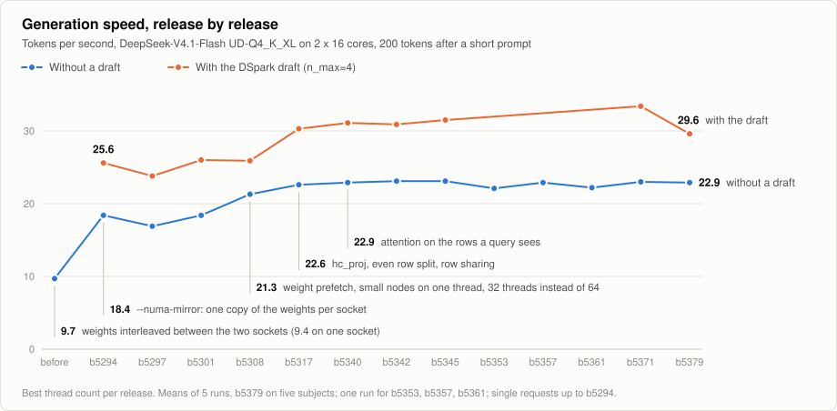
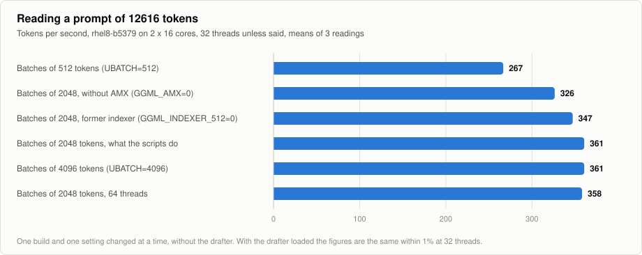

# ik_llama.cpp: llama.cpp fork with better CPU performance

[](https://opensource.org/licenses/MIT)

## This fork

This repository follows [ikawrakow/ik_llama.cpp](https://github.com/ikawrakow/ik_llama.cpp) and adds what it took to run **DeepSeek-V4.1 on CPUs only, on a server with several sockets**, from the GGUF files that upstream llama.cpp produces (for example [unsloth/DeepSeek-V4.1-Flash-1017-GGUF](https://huggingface.co/unsloth/DeepSeek-V4.1-Flash-1017-GGUF)). Everything after this section is the README of ik_llama.cpp, unchanged. What each release changed and what was measured with it: [Release by release](#release-by-release).

### What it adds

| Addition | What it does | Switch |
|---|---|---|
| Upstream DeepSeek-V4.1 GGUFs | They load as they are, MXFP8 engram table and DSpark draft included. That covers the `UD-Q4_K_XL` files, in spite of the note about `_XL` files below. | |
| `--numa-mirror DIR[,DIR]` | One copy of the model files per NUMA node: each thread reads the weights from the memory of its own socket. Implies `--numa distribute`. | |
| Weight prefetch | The kernels of `Q8_0_R8`, `MXFP4_R8`, `Q4_K_R4`, `Q5_K_R4` and `Q6_K_R4` ask for the weights 4 kB ahead. For weights that are not in the cache, one Sapphire Rapids core reads about 12 GB/s instead of 7 to 10. | `IQK_PREFETCH=<bytes>`, `0` = off |
| Serial small nodes | Thread 0 computes the small nodes of a graph alone; the other threads do not meet at a barrier for them. | `GGML_SERIAL_NODES=0` |
| `hc_proj` | The norm, the projection and the collapse of the DeepSeek-V4 hyper-connections in one node, each thread on the part of the streams it has just written. | `GGML_HC_PROJ=0` |
| Even row split | The rows of `Q8_0_R8` matrices go to the threads in groups of 8, no thread more than one group above another; the expert rows are taken in smaller chunks. | |
| Row sharing | A thread that is done with its rows of a large matrix product computes rows the others have not started on. The values do not depend on who computes them. | `GGML_SHARE_ROWS=0` |
| Attention on the rows in view | With one K/V head and fewer than 8 query tokens (DeepSeek-V4 decoding, with or without a draft), the attention is computed on the 32-row blocks of the cache that a query sees, not on the whole padded cache. The threads form a grid, groups of rows by groups of heads, sized so that a thread neither fetches all the rows nor combines many partial results; an index list that only repeats the mask is not gathered first. | `GGML_FA_SKIP_MASKED=0`, `GGML_FA_ROW_GROUPS=<n>` (1 = no groups of rows, -1 = drawn for every node: the profile then compares them), `GGML_FA_PARTS_AHEAD=0` |
| Draft tokens after a long context | Once the context has more compressed rows than the indexer picks, the attention of DeepSeek-V4 gets the cache rows of each token of a draft as a list, not the same rows for every token. The same grid of threads takes them: a thread copies, for one token after the other, the rows of its list that fall to its group of rows, and computes that token on them. Before, every thread copied all the rows of a token. | `GGML_FA_SKIP_MASKED=0` |
| The cache of DeepSeek-V4 read in its two parts | For every attention node the last raw rows and the compressed rows were copied next to each other first. In the graphs of a draft after a long context that is all the compressed rows of the context, for 35 layers, at every step: 1.3 ms of a step with 3165 tokens of context, and it grows with the context. On the CPU the copy is now left undone and the attention reads the rows in the two caches; where it cannot (8 query tokens or more, another kernel), it makes the copy itself first. Rows gathered that way come from the memory, so the next ones of the list are asked for in advance. The two caches are sources of the attention node, so that the memory of the graph that holds them is not given to another tensor before the node has run. In `rhel8-b5350` to `rhel8-b5353` it could be given to the result of the node itself, which was then written over rows still to be read wherever the threads formed a single row group and several tokens were decoded together: wrong values for these tokens, and in one case NaN and an abort after a prompt of 20000 tokens. | `GGML_LAZY_CONCAT=0`, `GGML_FA_ROWS_AHEAD=0` |
| Attention sinks for a token decoded alone | With one query token and one K/V head, two of the three ways the threads share the attention left the sinks out of the softmax: a token decoded alone did not get the result of the same token in a batch. They are applied everywhere now. | |
| The indexer of DeepSeek-V4 with AVX-512 | Before the attention, the indexer of DeepSeek-V4 scores every compressed row of the context against the 32 query heads of each token and gives the 512 best rows. In the profile of a 20000-token prompt it took 5% of a 512-token batch at the start and 10% at the end, and 3% of a generated token. With AVX-512 and keys in f16, a key row is now multiplied with all the heads at once in 512-bit registers, the keys are converted once for 8 tokens instead of once per token, and the best rows are found by counting the scores that reach a value, bit by bit, in place of a partial sort. With fewer tokens than threads (a token decoded alone, a draft) the threads wait for each other once per node, not two to four times per token. On 4 Sapphire Rapids cores, a batch of 512 tokens over 5120 rows (a context of 20000 tokens) takes 28 ms instead of 160, and a token decoded alone 0.13 ms instead of 0.29 (`test-indexer-topk --bench`). On the 2-socket server, with 15761 tokens of context: 30 ms of a 512-token batch instead of 108, 0.55 ms of a generated token instead of 1.03, and the prompt is read 4% faster. The rows chosen are the same: the two ways were run on the same nodes of DeepSeek-V4.1 graphs, 1832 tokens x layers, and never chose another row. They are given in the order of the rows, no longer of the scores; for a token decoded alone the attention sums over them in that order, so its result can differ in the last bits. The other way is still what a build without AVX-512 takes. There, for a token decoded alone, up to 7 of the newest rows got a better bucket than the others (a value cut where the others were rounded), so one of them could be taken in place of a row with a slightly higher score; they are rounded alike now. | `GGML_INDEXER_512=0` |
| Profile | For every kind of node: time per token, how busy the threads were, how fast the weights were read. For the attention above: how many nodes went which way, with how many groups of rows, and how long they took. | `GGML_PROFILE=1` |
| Tool arguments (DeepSeek tool calls) | The grammar that holds a tool call to the schema of the tool took `{}`, the schema that accepts anything, for "a JSON object" wherever it stood: in an array declared `"items": {}` the model could only write objects. Metabase declares the table and every clause of its query builder that way, so a model could not write a query for it and called the tool again and again. `{}` inside a schema is now any value. The arguments of a tool that does not say `"strict": true` are also held as JSON Schema means them, not as an output format: properties in any order, and others than those the schema names (Metabase's `limit`); types, `const`, `enum` and array lengths still apply. A JSON answer asked for with `response_format` is as strict as before. | `LLAMA_TOOL_ARGS_STRICT=1` |
| DeepSeek's API, for the clients written for it | The server takes what a client of DeepSeek's API sends, the way DeepSeek's reference conversion takes it ([deepseek-recipe](https://github.com/deepseek-ai/deepseek-recipe)): `"thinking": {"type": "enabled" \| "adaptive" \| "disabled"}` turns the reasoning on or off, and `"reasoning_effort"` (chat completions) or `"output_config": {"effort": ...}` (`/v1/messages`) sets its amount: `low`, `high`, `max` or a number from 1 to 100, `minimal` being `low`, `medium` and `xhigh` being `high`, `ultra` being `max`. Without `thinking`, an effort of `none` turns the reasoning off and any other turns it on; a value that is none of these gets the default. A request's own `chat_template_kwargs` still wins. The model is shown a tool as its name, description and parameters, without `strict`, and no tools when the request says to call none. The text blocks of a message, of the system prompt and of a tool result are joined with a blank line; they used to be joined with one line break, or glued. On `/v1/messages`, a block of a tool call opens with `"input": {}` as Anthropic's API opens it (a client may refuse it otherwise), the results of tools and the text after them keep their order, and reasoning is no longer cut at 10000 tokens when the request names no budget. The line breaks the model writes before its block of calls are not given as text of the answer: sent back by the client, they stood twice in the prompt. For twelve requests that go through these cases, the prompt is the one the reference builds, character for character, with DeepSeek's template and with Unsloth's. | |
| The template in Unsloth's GGUF files of DeepSeek-V4.1 | These files carry Unsloth's port of DeepSeek's chat template, and a server started without `--chat-template-file` works with it. It was not recognized as a DeepSeek template, so its tool calls went through the generic analysis of templates: the grammar wrote `string="true"` for every parameter, where the model writes `string="false"` before a JSON value and the template writes it so when the call comes back in the history, and it held objects to the order and the properties of their schema. The handling of tool arguments in the row above therefore did not reach such a server. The port is now recognized (`models/templates/unsloth-DeepSeek-V4.1-Flash-1017.jinja` is a copy, for the tests). | |
| Web UI of llama.cpp | `--webui llamacpp` serves the current web UI of llama.cpp ("Llama Chat"), a build of many files, in place of the older single-page copy. Its files are in `examples/server/public_llamacpp`, with the commit they were built from; `scripts/update-webui-llamacpp.sh` replaces them with a newer build. | `--webui llamacpp` |
| `llama-quantize ... COPY` with `--custom-q` | Requantizes only the tensors a rule names and copies the rest. With `--keep-split --partial-requant` only the split files that change are written. | |
| Release for RHEL 8 | CPU-only binaries for glibc 2.28, see below. | |

The switches are environment variables. The optimizations are on by default, and `=0` turns one off to compare on a given machine. The profile is off unless it is asked for. `GGML_POISON=1` is for debugging: it fills the work buffer of a graph and the place of a concatenation left undone with NaN, so that reading memory that was not written shows every time.

### Binaries

The [releases](https://github.com/muller-camille/ik_llama.cpp/releases) named `rhel8-b<number>` are CPU-only builds for RHEL 8.10 (Linux x64, glibc 2.28). A package holds three static builds (`avx2`, `avx512`, `avx512-bf16`) and launchers that start the one matching the CPU; nothing has to be installed. The workflow is `.github/workflows/release-rhel8.yml`.

```
curl -L -O https://github.com/muller-camille/ik_llama.cpp/releases/download/rhel8-b5371/ik_llama-rhel8-b5371-bin-rhel8-x64.tar.gz
tar xzf ik_llama-rhel8-b5371-bin-rhel8-x64.tar.gz
./ik_llama-rhel8-b5371/llama-server --version
```

A package also holds the shell scripts used on the 2-socket machine below (`scripts/deepseek` in this repository; their messages are in French). They use the tools next to them, and read what is specific to the machine (`NFS`, `API_KEY`, `HOST`, ...) from `~/.deepseek.conf`, one `NAME=value` per line:

| Script | What it does |
|---|---|
| `deepseek.sh` | loads the model into RAM, one copy of the weights per socket, and starts the server; with the draft model, its repacked file (`llama-quantize --repack <drafter> <drafter>-R8.gguf Q8_0_R8`) when that is in the folder of the model files: a draft call took 9.5 ms instead of 11.5 with it. The prompt is read in batches of 2048 tokens (`UBATCH`, the server's `-ub`; the server's own default is 512). With `--swa-compress` the 19 decoder layers of DeepSeek-V4.1 are computed for the last 256 tokens of a batch only, so the larger the batch, the smaller the share of the prompt that goes through them: one token in eight instead of one in two. The expert weights, which are read from the memory once per batch, serve four times the tokens as well. On the 2-socket server a prompt of 15761 tokens is read at 329 tokens/s in batches of 2048 against 245 in batches of 512, and the text after it is generated at the same speed. `UBATCH=512` goes back to the server's default |
| `charger-deepseek.sh` | the loading alone, as root |
| `mesure.sh` | starts a server of its own and measures the speed, with or without a draft |
| `profil.sh` | the same with `GGML_PROFILE=1`, in one run: without and with the drafter it finds next to the model, after a short prompt and after one of 16000 tokens, with one thread per physical core and then one per logical CPU; then one setting changed at a time (`VARS`: batches of 512 and of 4096 tokens, and every optimization of the table above that has a switch). A pass makes 5 requests, and after the long prompt 3 of them read a new text, which the server cannot take from its cache. 28 passes and about 2 hours on 2 x 16 cores with hyperthreading, with the usual server stopped; `RAPIDE=1` makes 12 in 20 minutes, and Ctrl+C keeps what is done. The result file ends with a table, one line per pass: tokens read, reading speed, generation speed with its lowest and highest try, share of the draft accepted |
| `drafter.sh` | tries several settings of the DSpark draft |
| `recompresser.sh` | requantizes the non-expert `Q8_0` tensors and installs the result next to the model |
| `harness.sh` | starts [DeepSeek Harness](https://github.com/deepseek-ai/deepseek-harness) (`dsh`: an agent with a web UI and a command line) with this server in the place of DeepSeek's API, see below |

### DeepSeek Harness

[DeepSeek Harness](https://github.com/deepseek-ai/deepseek-harness) is DeepSeek's open-source agent: a web UI, a command line and a headless mode around a model that reads and edits files and runs commands. Its own adapter for DeepSeek's API speaks the Messages protocol, which the server has at `/v1/messages`, and its model `deepseek-flash` is DeepSeek-V4.1 Flash. `harness.sh` starts it with the server of `deepseek.sh` in the place of that API:

```
npm install -g @deepseek-ai/dsh        # once; needs Node.js 24.9 or newer
./harness.sh                           # web UI on 127.0.0.1:3080, the address to open is printed
./harness.sh headless "run the tests"  # one task, the answer on the output
```

The script reads `API_KEY`, `HOST`, `PORT` and `CTX` from `~/.deepseek.conf` like the others (`SERVEUR=http://host:8080` for a server on another machine) and gives the harness an overlay (`dsh --patch`) that is rewritten at each start: the address of the server, the size of its context, so that the harness summarizes the conversation before the server runs out of it, and the reasoning level (`EFFORT=off|low|high|max`, also chosen in the UI). Nothing is written into the profiles of the harness, and the other providers set there stay as they are. The key is passed in the environment, not in a file.

- The agent runs, on the machine and with the account that start it, the commands the model decides to run. Start it in a work folder, with an account that has only the rights it should have; the script refuses to run as root unless told to (`EN_ROOT=1`, for a container).
- The web UI listens on this machine only. From another machine: `ssh -L 3080:127.0.0.1:3080 user@server`, then the printed address. `H_HOST` binds another address; over plain HTTP the address, which carries the access token, then travels in clear.
- The harness has telemetry towards DeepSeek, by default with the feedback a user submits; the script turns it off (`DSH_TELEMETRY_DISABLED`), and `TELEMETRIE=1` leaves it as the harness sets it.
- The server has one slot: the agents the harness can run side by side take turns on it.

Checked here with version 0.2.2-rc.5 of the harness and a small model in place of DeepSeek-V4.1: the web UI and the headless mode, a tool call and its result through the server and back, with and without internet access. The release workflow can repeat the headless run on a RHEL 8.10 image (`test_harness`); it did for `rhel8-b5352`, with Node.js 24.22.3 from nodejs.org.

### Release by release

Every release of this fork, what it changed, and what was measured with it on the server of the next section (2 x 16 cores, 200 tokens generated). The figures are tokens per second. "Long prompt" is the generation after a prompt of 3159 to 3165 tokens up to `rhel8-b5345` and of 19714 tokens from `rhel8-b5353` on (15761 for `rhel8-b5361`); "prompt read" is the speed at which that prompt was read. An empty cell was not measured: a release that only fixes something, or that the next one replaced the same day.

<picture>
  <source media="(prefers-color-scheme: dark)" srcset="media/deepseek-releases-dark.svg">
  
</picture>

The chart takes, for each release that was measured, the short-prompt figures of the table below at the best thread count measured (64 threads up to `rhel8-b5301`, 32 from `rhel8-b5308` on). `python3 scripts/release-chart.py` draws it again from the figures written in that script.

<picture>
  <source media="(prefers-color-scheme: dark)" srcset="media/deepseek-prompt-dark.svg">
  
</picture>

The reading of a long prompt did not move before `rhel8-b5360`. The three bars are one prompt read by one build, `rhel8-b5361`, with one setting changed at a time: the indexer gives 4%, the batches of 2048 tokens 34% more. With `--swa-compress` the server computes the 19 decoder layers of DeepSeek-V4.1 for the last 256 tokens of a batch only: in batches of 2048 that is one token of the prompt in eight instead of one in two. The generation after that prompt runs at the same speed in the three cases, within what two runs differ by.

| Release | What it changed | Threads | Short prompt | With the draft | Long prompt | Long prompt, draft | Prompt read |
|---|---|---|---|---|---|---|---|
| `rhel8-b5284`, 19 Nov | First release: CPU binaries for RHEL 8 (glibc 2.28). The DeepSeek-V4.1 GGUFs of upstream llama.cpp load as they are, MXFP8 engram table included. | | | | | | |
| `rhel8-b5288` | The DSpark draft of upstream llama.cpp loads (`-md ... --spec-type dspark`). | | | | | | |
| `rhel8-b5290` | The data of MXFP8 tensors is checked when a model loads. | | | | | | |
| | Before `--numa-mirror`: all the weights on one NUMA node, then interleaved between the two | 32 | 9.4, 9.7 | | | | |
| `rhel8-b5293`, 20 Nov | `--numa-mirror`: one copy of the weights per NUMA node, each thread reads from its own socket. Measured with the next release. | | | | | | |
| `rhel8-b5294` | Fix: flash attention gives the same result with any number of threads. | 32 | 17.1 | | | | |
| | | 64 | 18.4 | 25.6 | | | |
| | | 16 | 12.2 | | | | |
| `rhel8-b5296` | Small nodes computed by one thread, first attempt. | | | | | | |
| `rhel8-b5297` | Fix: the Markov table of the DSpark draft is not repacked. Slower by 8%: the first attempt at serial nodes, taken back in the next release. | 64 | 16.9 | 23.8 | | | |
| `rhel8-b5301` | `GGML_PROFILE=1`, the profile of the graphs. | 64 | 18.4 | 26.0 | | | |
| | | 32 | 18.0 | | | | |
| | | 16 | 12.4 | | | | |
| `rhel8-b5305` | Serial small nodes, second attempt: thread 0 computes them alone and the others do not meet for them. `rms_norm`, `hc_post`, `rope` and `argmax` take less time. Measured with the next release. | | | | | | |
| `rhel8-b5308` | Weight prefetch for `Q8_0_R8` and `MXFP4_R8`. From here on 32 threads are faster than 64. | 64 | 20.0 | 25.9 | | | |
| | | 32 | 21.3 | | | | |
| | The same with `IQK_PREFETCH=0`, then with `GGML_SERIAL_NODES=0` | 64 | 19.4, 19.3 | 25.1 (no prefetch) | | | |
| `rhel8-b5313` | Weight prefetch for `Q4_K_R4`, `Q5_K_R4`, `Q6_K_R4`. `llama-quantize ... COPY --custom-q` requantizes only the tensors a rule names. | | | | | | |
| `rhel8-b5315` | `hc_proj`: the norm, the projection and the collapse of the hyper-connections in one node. The rows of `Q8_0_R8` split evenly between the threads. Measured with the next release. | | | | | | |
| `rhel8-b5317` | Row sharing: a thread that is done takes rows the others have not started. | 32 | 22.6 | 30.3 | | | |
| | | 64 | 20.8 | | | | |
| | The same with `GGML_SHARE_ROWS=0`, then with `GGML_HC_PROJ=0` | 32 | 22.2, 20.5 | 30.1, 27.3 | | | |
| `rhel8-b5334`, 21 Nov | Brought up to date with ik_llama.cpp. The mean of the streams is computed only for the layers the draft reads. | | | | | | |
| `rhel8-b5335` | The DeepSeek scripts are in the release: `deepseek.sh`, `charger-deepseek.sh`, `drafter.sh`, `mesure.sh`, `profil.sh`, `recompresser.sh`. | | | | | | |
| `rhel8-b5338` | Attention with one K/V head: fix of the sinks for a token decoded alone, attention on the rows a query sees instead of the whole padded cache, all the threads for a draft. Measured with the next release. | | | | | | |
| `rhel8-b5340` | `--webui llamacpp`, the current web UI of llama.cpp. | 32 | 22.9 | 31.1 | 21.4 | 26.1 | 236 |
| `rhel8-b5342` | The threads of the attention in a grid, groups of rows by groups of heads. | 32 | 23.1 | 30.9 | 21.7 | 24.5 | |
| `rhel8-b5345` | The index lists of a draft on the same grid, each token on its own rows. | 32 | 23.1 | 31.5 | 21.9 | 27.7 | 234 |
| `rhel8-b5347` | Tool calls: `{}` in a schema is any value, and a tool that is not `strict` gets open objects. Metabase could not get a query written before. | | | | | | |
| `rhel8-b5349` | The number of row groups of the attention grid is chosen from what `rhel8-b5345` measured. | | | | | | |
| `rhel8-b5350` | The attention reads the cache of DeepSeek-V4 in its two parts, without copying them together first: 1.3 ms of a draft step at 3165 tokens of context, more with a longer one. It had a fault, see `rhel8-b5357`. | | | | | | |
| `rhel8-b5352`, 22 Nov | `harness.sh`, DeepSeek Harness on the server. The fields of DeepSeek's API (`thinking`, `reasoning_effort`). | | | | | | |
| `rhel8-b5353` | Unsloth's chat template is recognized as DeepSeek's, so the tool-call handling of `rhel8-b5347` reaches a server started from Unsloth's files. Prompts as DeepSeek's reference builds them. One run. A request that ends in a tool call, with the draft: 33.9. | 32 | 22.1 | | 21.2 | | 230 |
| `rhel8-b5357` | Fix: in `rhel8-b5350` to `rhel8-b5353` the result of an attention node could be written over cache rows it still had to read, when several tokens were decoded together with one row group: wrong values, and an abort after the 19714-token prompt with `GGML_FA_ROW_GROUPS=1` or `-1`. `GGML_POISON=1`. One run. | 32 | 22.9 | | 21.2 | | 230 |
| `rhel8-b5360` | The indexer of DeepSeek-V4 with AVX-512: 5% to 10% of a prompt batch and 3% of a generated token went there at 20000 tokens of context. On 4 cores, a batch of 512 tokens over 5120 rows takes 28 ms instead of 160. Fix of the rounding of the buckets in the former way. Measured with the next release. | | | | | | |
| `rhel8-b5361` | `UBATCH=<n>` in `deepseek.sh` and `profil.sh` sets the size of the prompt batches, still 512 unless it is set. One run. With the indexer of `rhel8-b5360`, `INDEXER_TOPK` takes 30 ms of a 512-token batch instead of 108, and 0.55 ms of a generated token instead of 1.03. | 32 | 22.2 | | 21.1 | | 245 |
| | The same with `GGML_INDEXER_512=0`, the former indexer | 32 | 22.6 | | 21.6 | | 236 |
| | The same with `UBATCH=2048`: the 19 decoder layers, computed for the last 256 tokens of a batch only, see one token of the prompt in eight instead of one in two; a batch takes 2.63 ms per token plus 0.71 s | 32 | 22.5 | | 21.7 | | 329 |
| `rhel8-b5369` | The scripts read the prompt in batches of 2048 tokens unless `UBATCH` says otherwise. The binaries are built from the sources of `rhel8-b5361`, whose line above gives the figures. | | | | | | |
| `rhel8-b5370` | `profil.sh` measures in one run without and with the drafter, with one thread per core and one per logical CPU, after a short and after a long prompt, and ends with a table of the passes. Same sources for the binaries. | | | | | | |
| `rhel8-b5371` | `profil.sh` by default: every switch compared, batches of 512 and of 4096 tokens, 5 tries per pass of which 3 read a new long text, the lowest and the highest try in the table. `RAPIDE=1` for the short version. Same sources for the binaries. | | | | | | |

From `rhel8-b5297` on the figures are means of 5 runs, except where one run is said; before, they are single requests. The runs of one build differ by up to 3%. Those with the draft (DSpark, `n_max=4`) also move with the share of draft tokens the model accepts, which depends on the text: 58% to 74% in these runs. `rhel8-b5340` to `rhel8-b5345` generate another text than `rhel8-b5317` because of the fix of the sinks.

From the first measurement to the last one, on the same machine and the same model files: 9.4 tokens/s with the weights on one node, 17.1 with a copy per node, 22.9 now; with the draft, 25.6 then and 31.5 now. A prompt was read at 230 to 236 tokens/s in every release up to `rhel8-b5357`; `rhel8-b5361` reads one at 245, and at 329 in batches of 2048 tokens.

### DeepSeek-V4.1 on a 2-socket server

For one token DeepSeek-V4.1-Flash (`UD-Q4_K_XL`) reads 12.9 GB of weights, and they do not stay in any cache. The speed is the speed of the memory, so the set-up is about where the weights are and which thread reads them.

1. Repack the files once. `--numa-mirror` maps the weights from the files, so `-rtr` cannot be used with it:

   ```
   ./llama-quantize --repack --keep-split DeepSeek-V4.1-Flash-1017-UD-Q4_K_XL-00001-of-00009.gguf \
       /models/DeepSeek-V4.1-Flash-1017-UD-Q4_K_XL-R8.gguf COPY
   ```

2. Keep one copy of the weight files per NUMA node in RAM, each on a tmpfs bound to its node. The engram table (file 8 of 9, 200 GB) is read sparsely and can stay shared: link it into the first directory only.

   ```
   mount -t tmpfs -o size=300G,huge=always,mpol=bind:0 tmpfs /mnt/ds0
   mount -t tmpfs -o size=300G,huge=always,mpol=bind:1 tmpfs /mnt/ds1
   # files 1-7 and 9 in both directories, file 8 linked into /mnt/ds0
   ```

3. Start with one thread per physical core. On the machine below 32 threads are faster than 64: the weights arrive at the same rate either way.

   ```
   numactl --interleave=all ./llama-server \
       -m /mnt/ds0/DeepSeek-V4.1-Flash-1017-UD-Q4_K_XL-R8-00001-of-00009.gguf --numa-mirror /mnt/ds1 \
       -t 32 -c 131072 --jinja --swa-compress
   ```

   The log tells which node holds each copy.

4. Optionally add the DSpark draft of the same repository. It does not change the output; the log prints the acceptance rate:

   ```
       -md /mnt/ds0/dspark-DeepSeek-V4.1-Flash-1017-Q8_0.gguf --spec-type dspark:n_max=4
   ```

Measured on a server with 2 x 16 Sapphire Rapids cores and 8 DDR5 channels per socket, 200 tokens generated after a short prompt:

| Build | Threads | Draft | Tokens/s |
|---|---|---|---|
| `rhel8-b5301` | 64 | | 18.4 |
| `rhel8-b5308` (serial nodes, prefetch) | 64 | | 20.0 |
| `rhel8-b5308` | 32 | | 21.3 |
| `rhel8-b5317` (`hc_proj`, even row split, row sharing) | 64 | | 20.8 |
| `rhel8-b5317` | 32 | | 22.6 |
| `rhel8-b5301` | 64 | DSpark, `n_max=4` | 26.0 |
| `rhel8-b5308` | 64 | DSpark, `n_max=4` | 25.9 |
| `rhel8-b5317` | 32 | DSpark, `n_max=4` | 30.3 |

`rhel8-b5340` (attention sinks for a token decoded alone, attention on the rows in view), 32 threads:

| Prompt | Draft | Tokens/s | Attention per graph |
|---|---|---|---|
| short | | 22.9 | 1.9 ms |
| short | DSpark, `n_max=4` | 31.1 | 2.9 ms for 3.3 tokens |
| 3159 tokens | | 21.4 | 2.7 or 5.6 ms |

With a context of a few thousand tokens the attention is the largest cost that is not reading weights. The text differs from `rhel8-b5317` because of the sinks, and with it the share of accepted draft tokens (63% here, 74% there): a draft step takes 74.4 ms instead of 78.3 ms, for about the same tokens/s on these texts.

`rhel8-b5342` (the threads of the attention in a grid, groups of rows by groups of heads), 32 threads, and the same without groups of rows:

| Prompt | Draft | Tokens/s | Attention per graph | `GGML_FA_ROW_GROUPS=1` |
|---|---|---|---|---|
| short | | 23.1 | 1.5 ms | 22.6, 1.9 ms |
| 3165 tokens | | 21.7 | 2.9 ms | 20.6, 5.1 ms |
| short | DSpark, `n_max=4` | 30.9 | 3.0 ms for 3.4 tokens | 30.9, 3.1 ms |
| 3165 tokens | DSpark, `n_max=4` | 24.5 | 8.9 ms for 3.0 tokens | |

In the last line a draft step takes 67.2 ms, and 58% of the draft tokens were accepted on this text.

`rhel8-b5345` (the lists of a draft on the grid of threads), 32 threads:

| Prompt | Draft | Tokens/s | Attention per graph |
|---|---|---|---|
| short | | 23.1 | 1.5 ms |
| 3165 tokens | | 21.9 | 2.9 to 3.0 ms |
| short | DSpark, `n_max=4` | 31.5 | 3.0 ms for 3.4 tokens |
| 3165 tokens | DSpark, `n_max=4` | 27.7 | 7.2 ms for 3.0 tokens |

In the last line a draft step takes 64.4 ms instead of 67.2, and 68% of the draft tokens were accepted on this text (58% in the run of `rhel8-b5342`, hence most of the difference in tokens/s). The same release with the number of row groups drawn for every node (`GGML_FA_ROW_GROUPS=-1`), time of thread 0 in an attention node, in microseconds:

| Row groups | 1 | 2 | 4 | 8 |
|---|---|---|---|---|
| one token, 672 rows read in place | 99 | 73.6 | 59.5 | 65.1 |
| about 3 tokens of a draft, 640 rows of each gathered | 258 | 210.6 | 171.7 | 186.5 |

With one row group a thread does not wait for the others, so its time understates the node. Asking for the rows in advance before copying them made no difference (171.4 against 172.0 with 4 row groups) and was removed. The choice of the number of row groups goes by these figures since `rhel8-b5349`.

With `rhel8-b5317` and 32 threads, one optimization turned off at a time:

| Switch | Tokens/s | With the draft |
|---|---|---|
| none | 22.6 | 30.3 |
| `GGML_SHARE_ROWS=0` | 22.2 | 30.1 |
| `GGML_HC_PROJ=0` | 20.5 | 27.3 |

Each figure is the mean of 5 runs of 200 tokens, and the runs of one build differ by up to 3%, so the 2% of the row sharing is at the limit of what this shows. The draft was accepted at 74% in these runs (68% in the run with `GGML_HC_PROJ=0`, whose text differs), so its gain depends on the text.

### Where the time goes

```
GGML_PROFILE=1 ./llama-server -m model.gguf ... 2> server.log    # stop it with Ctrl+C
grep ggml_profile server.log
```

A line per kind of node, the layers added up: milliseconds per graph, share, how busy the threads were (all, the even ones, the odd ones, the least and the most busy one) and the GB/s of weights read. A node whose threads are far from 100% busy is waiting for something else than its own work.

### Fewer bytes per token

Once the memory sets the speed, the remaining lever is to read less. The `Q8_0` tensors of `UD-Q4_K_XL` that are not experts (attention, shared expert, output) are 7.9 of the 12.9 GB read per token. This requantizes them to `Q6_K` and writes only the last split file again, 7.3 GB instead of 9.2:

```
# in the output directory, link the files 1-8 under the new name first: they are not written again
./llama-quantize --allow-requantize --keep-split --partial-requant \
    --custom-q '^(blk\.[0-9]+\.(attn_kv|attn_q_[ab]|attn_output_[ab]|ffn_(up|gate|down)_shexp|engram_kv|attn_compressor_(gate|kv)|indexer\.(proj|attn_k|attn_q_b))|output)\.weight$=q6_k_r4' \
    DeepSeek-V4.1-Flash-1017-UD-Q4_K_XL-R8-00001-of-00009.gguf DeepSeek-V4.1-Flash-1017-UD-Q4_K_XL-R8Q6.gguf COPY
```

This changes the model. On random weights the error of these tensors goes from 0.5% (`Q8_0`) to 1.8%; **the effect on the quality of the answers is not measured**, and neither is the gain on the 2-socket server (estimated at 8 to 12%).

## TL;DR

Fork of [llama.cpp](https://github.com/ggerganov/llama.cpp), started in June 2024 and last synced in August 2024. It adds SOTA quantization types and often better performance. Many inference features landed here first: MLA, quant repacking, fused delta-net (GDN in `llama.cpp`), tensor parallel, MTP, DFlash. As of late 2026 it has diverged substantially from upstream. See [Latest News](#latest-news) for recent changes and [Model Support](#model-support) / [Quantization](#quantization) for the full lists.

>[!IMPORTANT]
>If you are running hybrid CPU/GPU inference for MoE models with all or some experts left on the CPU, **do not use -rtr** unless you know what you are doing. The `-rtr` option causes all tensors left in RAM to be repacked to row-interleaved format while loading the model. As not all quantization types have a CUDA implementation, this will result in matrix multiplications with these tensors to be **always done on the CPU**, even when it would have been much better to offload the computation to the GPU, typically resulting in lower prompt processing speed. Most notably, k-quants (`Q2_K, Q3_K, Q4_K, Q5_K, Q6_K`) do not have CUDA row-interleaved implementation.

>[!NOTE]
>The only fully functional and performant compute backends are CPU (`AVX2` or better, `ARM_NEON` or better) and CUDA (Turing or newer; Pascal and Volta are functional, but some flash-attention steps fall back to the CPU, see [here](docs/pascal-volta.md) for details)
>Please do not enter issues related to ROCm, Vulkan, Metal, old Nvidia GPUs, `AVX` CPUs, etc. They will not get resolved unless you roll up your sleeves and help bring your favorite backend up to speed. With the current regular contributors this project simply does not have the bandwidth to work on all backends available in `llama.cpp`.
 
>[!IMPORTANT]
>Do not use quantized models from Unsloth that have `_XL` in their name. These are likely to not work with `ik_llama.cpp`.
>
>The above has caused some stir, so to clarify: the Unsloth `_XL` models that are likely to not work are those that contain `f16` tensors (which is never a good idea in the first place). All others are fine.

>[!NOTE]
>Some users have reported issues with graph parallel (a.k.a. split mode `graph`) and partial GPU offload (using `--cpu-moe` or `--n-cpu-moe` or tensor overrides). If you are using/want to use split mode graph and observe gibberish/incoherent responses, try adding `-cuda graphs=0` to your command line.

## Highlights

- Split mode `graph`: graph-parallel multi-GPU inference ([details](#features))
- MLA and FlashMLA on CPU and CUDA ([details](#flash-mla))
- IQK quantization: AVX-512 repacking, trellis and ternary types ([details](#quantization))
- Speculative decoding: MTP, DFlash and self-speculation ([details](#features))
- MoE: dynamic expert cache and on-demand tensor reload ([details](#features))
- Backends: CPU and CUDA, including multi-GPU CUDA quantization ([details](#features))

## Quickstart

### Prerequisites

```
git clone https://github.com/ikawrakow/ik_llama.cpp

cd ik_llama.cpp
```

On Debian/Ubuntu Linux, install the required packages (if using another Linux distro, you need to find the corresponding packages and adapt):

```
apt-get update && apt-get install build-essential git libcurl4-openssl-dev curl libgomp1 cmake
```

### Build for CPU

```
cmake -B build -DGGML_NATIVE=ON

cmake --build build --config Release -j$(nproc)
```

For AVX-512-capable CPUs (AMD Zen4 / Intel Sapphire Rapids+), see
[`docs/build.md`](docs/build.md) section "CPU build flags for AVX-512" for the
additional flags that activate the IQK quantized GEMM kernels (the
`HAVE_FANCY_SIMD` path). Without those flags, a vanilla `Release` build
silently falls back to the AVX2 path on this hardware.

### Build for GPU

Install Nvidia Drivers and [CUDA Toolkit](https://developer.nvidia.com/cuda/toolkit).

```
cmake -B build -DGGML_NATIVE=ON -DGGML_CUDA=ON

cmake --build build --config Release -j$(nproc)
```
### Windows build
For step-by-step instructions for a successful Windows build, see [docs/build.md](docs/build.md).

### Run

Download `.gguf` model files (e.g. [bartowski/Qwen_Qwen3-0.6B-IQ4_NL.gguf](https://huggingface.co/bartowski/Qwen_Qwen3-0.6B-GGUF/blob/main/Qwen_Qwen3-0.6B-IQ4_NL.gguf)) to your favorite directory (e.g. `/my_local_files/gguf`).

Start the server with one of the commands (CPU or GPU):

```
./build/bin/llama-server --model /my_local_files/gguf/Qwen_Qwen3-0.6B-IQ4_NL.gguf --ctx-size 4096
```

```
./build/bin/llama-server --model /my_local_files/gguf/Qwen_Qwen3-0.6B-IQ4_NL.gguf --ctx-size 4096 -ngl 999
```

That's all! Open [http://127.0.0.1:8080](http://127.0.0.1:8080) in Browser and start chatting, or use the available API endpoints in your program/harness.

### Run in Docker or Podman

Pull one of the available images from `ghcr.io`. [View all tags](https://github.com/ikawrakow/ik_llama.cpp/pkgs/container/ik-llama-cpp/versions?filters%5Bversion_type%5D=tagged)

```bash
docker pull ghcr.io/ikawrakow/ik-llama-cpp:cpu-swap
docker pull ghcr.io/ikawrakow/ik-llama-cpp:cpu-server
docker pull ghcr.io/ikawrakow/ik-llama-cpp:cpu-full

docker pull ghcr.io/ikawrakow/ik-llama-cpp:cu12-swap
docker pull ghcr.io/ikawrakow/ik-llama-cpp:cu12-server
docker pull ghcr.io/ikawrakow/ik-llama-cpp:cu12-full

docker pull ghcr.io/ikawrakow/ik-llama-cpp:cu13-swap
docker pull ghcr.io/ikawrakow/ik-llama-cpp:cu13-server
docker pull ghcr.io/ikawrakow/ik-llama-cpp:cu13-full
```

Check [Step by step guide](./docker/README.md) for image customization and other details.

### [Common parameters and options](./docs/parameters.md)

## Latest News

_Last updated: 2026-11-17. Newest first. Older entries are in the sections below._

**Models**

- Step-5-Preview (dense text; sparse indexer, MTP, SWA-compress and vision pending) [PR 2914](https://github.com/ikawrakow/ik_llama.cpp/pull/2914)
- Raon-1 nano (3.1B dense hybrid: RDA + NoPE MLA + MTP) [PR 2903](https://github.com/ikawrakow/ik_llama.cpp/pull/2903)
- HY MT2-30B-A3B (Hunyuan V3 MoE, `hy_v3`) [PR 2900](https://github.com/ikawrakow/ik_llama.cpp/pull/2900)
- Ripple-65B Preview [PR 2852](https://github.com/ikawrakow/ik_llama.cpp/pull/2852)
- Xing4.0 [PR 2832](https://github.com/ikawrakow/ik_llama.cpp/pull/2832) [PR 2847](https://github.com/ikawrakow/ik_llama.cpp/pull/2847)
- GLM-OCR (text, MTP, vision) [PR 2814](https://github.com/ikawrakow/ik_llama.cpp/pull/2814)
- MiniMax-M3.1 conversion [PR 2793](https://github.com/ikawrakow/ik_llama.cpp/pull/2793)
- LFM3 (dense) [PR 2782](https://github.com/ikawrakow/ik_llama.cpp/pull/2782)
- Spark-X2.5 [PR 2770](https://github.com/ikawrakow/ik_llama.cpp/pull/2770)
- Raon-1 mini preview [PR 2759](https://github.com/ikawrakow/ik_llama.cpp/pull/2759)
- Flint MoE [PR 2725](https://github.com/ikawrakow/ik_llama.cpp/pull/2725)
- Maple (20B-A1B ternary MoE) [PR 2694](https://github.com/ikawrakow/ik_llama.cpp/pull/2694)
- DeepSeek-V4 / V4.1 [PR 2165](https://github.com/ikawrakow/ik_llama.cpp/pull/2165) [PR 2455](https://github.com/ikawrakow/ik_llama.cpp/pull/2455), vision [PR 2545](https://github.com/ikawrakow/ik_llama.cpp/pull/2545)
- Qwen-3.8-Flash-Next [PR 2365](https://github.com/ikawrakow/ik_llama.cpp/pull/2365)

**Quantization**

- Estimated imatrix: adds coupling for attention tensors; better PPL for dense models when combining estimated with computed imatrix [PR 2894](https://github.com/ikawrakow/ik_llama.cpp/pull/2894)
- CUDA Blackwell: native W4A4 NVFP4 on the FP4 tensor cores via `--nvfp4-precision` [PR 2868](https://github.com/ikawrakow/ik_llama.cpp/pull/2868)
- `NVFP4_KS` row-scale NVFP4 type, loads mainline/NVIDIA NVFP4 GGUFs [PR 2858](https://github.com/ikawrakow/ik_llama.cpp/pull/2858)
- `Q8_K_R16` / `Q8_0_R16` [PR 2764](https://github.com/ikawrakow/ik_llama.cpp/pull/2764) [PR 2765](https://github.com/ikawrakow/ik_llama.cpp/pull/2765)
- `Q8_0_R16` extended to `Q4_0`, `Q5_0`, `Q6_0`, `IQ4_NL` and `MXFP4` on AVX-512 [PR 2807](https://github.com/ikawrakow/ik_llama.cpp/pull/2807); faster `q8_k_r16` [PR 2813](https://github.com/ikawrakow/ik_llama.cpp/pull/2813)
- Gyro Trellis quants (`TQ2_T`, `TQK6`/`TQK7`, `TQP5`–`TQP7`) [PR 2812](https://github.com/ikawrakow/ik_llama.cpp/pull/2812)
- `Q2_0` 8-row repack (`Q2_0_R8`) [PR 2785](https://github.com/ikawrakow/ik_llama.cpp/pull/2785)
- `Q2_0`/`PQ2_0` CUDA offload [PR 2691](https://github.com/ikawrakow/ik_llama.cpp/pull/2691) [PR 2747](https://github.com/ikawrakow/ik_llama.cpp/pull/2747)

**Performance**

- CPU-resident experts: MoE combine runs on the CPU with `-ot 'ffn_.*_exps=CPU'`, cutting CPU→GPU copies ~9x [PR 2901](https://github.com/ikawrakow/ik_llama.cpp/pull/2901)
- CUDA: faster one-column BF16/F16 and NVFP4_KS mat-vec, helps quantized models keeping attention in BF16/F16 [PR 2892](https://github.com/ikawrakow/ik_llama.cpp/pull/2892)
- `deepseek41`: reuse selected rows [PR 2840](https://github.com/ikawrakow/ik_llama.cpp/pull/2840), fuse candidate pool block/position selection [PR 2819](https://github.com/ikawrakow/ik_llama.cpp/pull/2819)
- `raon`: MLA decode micro-optimizations [PR 2804](https://github.com/ikawrakow/ik_llama.cpp/pull/2804), shared expanded MLA prefill [PR 2799](https://github.com/ikawrakow/ik_llama.cpp/pull/2799)
- CUDA: MoE MMQ one block per row tile and expert [PR 2831](https://github.com/ikawrakow/ik_llama.cpp/pull/2831), Hadamard-aware CUDA graphs [PR 2824](https://github.com/ikawrakow/ik_llama.cpp/pull/2824), `qwen4exp` block scoring [PR 2809](https://github.com/ikawrakow/ik_llama.cpp/pull/2809)
- CPU: lower threading overhead [PR 2829](https://github.com/ikawrakow/ik_llama.cpp/pull/2829), fused scale→sigmoid→scale→FMA [PR 2823](https://github.com/ikawrakow/ik_llama.cpp/pull/2823) [PR 2805](https://github.com/ikawrakow/ik_llama.cpp/pull/2805), merged up/gate experts with Hadamard [PR 2822](https://github.com/ikawrakow/ik_llama.cpp/pull/2822), AVX-512 build options [PR 2818](https://github.com/ikawrakow/ik_llama.cpp/pull/2818)
- Sparse FA: `qwen4exp` QSA prefill [PR 2738](https://github.com/ikawrakow/ik_llama.cpp/pull/2738), `glm5next` DSA [PR 2723](https://github.com/ikawrakow/ik_llama.cpp/pull/2723), `DeepSeek-V4` compressed layers [PR 2714](https://github.com/ikawrakow/ik_llama.cpp/pull/2714)
- Long-context prefill: Qwen3.8-Flash-Next [PR 2757](https://github.com/ikawrakow/ik_llama.cpp/pull/2757) [PR 2751](https://github.com/ikawrakow/ik_llama.cpp/pull/2751), `deepseek41` SWA-bounded replay [PR 2743](https://github.com/ikawrakow/ik_llama.cpp/pull/2743)
- AVX-512: faster `KT` quants [PR 2724](https://github.com/ikawrakow/ik_llama.cpp/pull/2724), `IQ1_S`/`IQ1_M` token generation [PR 2705](https://github.com/ikawrakow/ik_llama.cpp/pull/2705)

**Features**

- MoE cache CPU share via `--moe-cache-cpu-share` [PR 2883](https://github.com/ikawrakow/ik_llama.cpp/pull/2883)
- Estimated imatrix from the model weights: `--estimate-imatrix`, `--analytical-imatrix FILE` [PR 2862](https://github.com/ikawrakow/ik_llama.cpp/pull/2862)
- `llama-bench`: common options and `-ncmoe` loader [PR 2841](https://github.com/ikawrakow/ik_llama.cpp/pull/2841)
- `qwen4exp`: GGUFs with merged weight pairs [PR 2816](https://github.com/ikawrakow/ik_llama.cpp/pull/2816)
- `ggml`: fused multiply-add (FMA) [PR 2794](https://github.com/ikawrakow/ik_llama.cpp/pull/2794)
- `minimax-m3`: BF16 indexer projections [PR 2792](https://github.com/ikawrakow/ik_llama.cpp/pull/2792)
- `minimax-m3`: CPU MSA behind `--dsa` [PR 2790](https://github.com/ikawrakow/ik_llama.cpp/pull/2790)
- Server: per-device memory on `/memory` and `/metrics` [PR 2776](https://github.com/ikawrakow/ik_llama.cpp/pull/2776)
- Tokenizer: NFC normalization via `tokenizer.ggml.normalizer.nfc` [PR 2735](https://github.com/ikawrakow/ik_llama.cpp/pull/2735)
- `-cuda max-graphs=N` [PR 2715](https://github.com/ikawrakow/ik_llama.cpp/pull/2715)
- Dynamic MoE expert cache [PR 2644](https://github.com/ikawrakow/ik_llama.cpp/pull/2644)

**Fixes**

- `llama-quantize`: NVFP4_KS conversions now keep the input `.input_scale` tensors, so converted files run W4A4 under `--nvfp4-precision auto` like the original; files converted earlier must be converted again from the source model [PR 2891](https://github.com/ikawrakow/ik_llama.cpp/pull/2891)
- Server: correct context-checkpoint positions, skip the KV scan until a checkpoint is due [PR 2870](https://github.com/ikawrakow/ik_llama.cpp/pull/2870)
- `IQ4_KSS`: pruning during quantization [PR 2834](https://github.com/ikawrakow/ik_llama.cpp/pull/2834)
- Server: EOG tokens with `--special` [PR 2828](https://github.com/ikawrakow/ik_llama.cpp/pull/2828), duplicate tokens when restoring checkpoints [PR 2827](https://github.com/ikawrakow/ik_llama.cpp/pull/2827), truncated content on tool-call prefixes [PR 2811](https://github.com/ikawrakow/ik_llama.cpp/pull/2811), banned strings with speculative decoding for recurrent models [PR 2772](https://github.com/ikawrakow/ik_llama.cpp/pull/2772), held-back stop strings and partial UTF-8 in chat streams [PR 2802](https://github.com/ikawrakow/ik_llama.cpp/pull/2802)
- CUDA: `TQ` quants looping in GEMV [PR 2821](https://github.com/ikawrakow/ik_llama.cpp/pull/2821), overlapping logits in top-k MoE fusion [PR 2780](https://github.com/ikawrakow/ik_llama.cpp/pull/2780), `IQ1_S_R4`/`IQ1_M_R4` correctness [PR 2708](https://github.com/ikawrakow/ik_llama.cpp/pull/2708), double-counted KV block in MMA FA [PR 2698](https://github.com/ikawrakow/ik_llama.cpp/pull/2698)
- `-sm graph`: abort with Cohere partial drop and uneven splits [PR 2775](https://github.com/ikawrakow/ik_llama.cpp/pull/2775); `-sm attn`: assert for Flint and Qwen3-MoE [PR 2744](https://github.com/ikawrakow/ik_llama.cpp/pull/2744)
- `IQ5_KS_R16`: AVX-512+VNNI GEMM [PR 2731](https://github.com/ikawrakow/ik_llama.cpp/pull/2731)

## Model Support

Newest first.

- Step-5-Preview dense text [PR 2914](https://github.com/ikawrakow/ik_llama.cpp/pull/2914)
- Raon-1 nano (3.1B dense hybrid: RDA + NoPE MLA + MTP) [PR 2903](https://github.com/ikawrakow/ik_llama.cpp/pull/2903)
- HY MT2-30B-A3B (Hunyuan V3 MoE, `hy_v3`) [PR 2900](https://github.com/ikawrakow/ik_llama.cpp/pull/2900)
- Ripple-65B Preview [PR 2852](https://github.com/ikawrakow/ik_llama.cpp/pull/2852)
- Xing4.0 [PR 2832](https://github.com/ikawrakow/ik_llama.cpp/pull/2832) [PR 2847](https://github.com/ikawrakow/ik_llama.cpp/pull/2847)
- GLM-OCR (text, MTP, vision) [PR 2814](https://github.com/ikawrakow/ik_llama.cpp/pull/2814)
- MiniMax-M3.1 conversion [PR 2793](https://github.com/ikawrakow/ik_llama.cpp/pull/2793)
- LFM3 (dense) [PR 2782](https://github.com/ikawrakow/ik_llama.cpp/pull/2782)
- Spark-X2.5 [PR 2770](https://github.com/ikawrakow/ik_llama.cpp/pull/2770)
- Raon-1 mini preview [PR 2759](https://github.com/ikawrakow/ik_llama.cpp/pull/2759)
- Flint [PR 2725](https://github.com/ikawrakow/ik_llama.cpp/pull/2725)
- Maple (20B-A1B ternary MoE) [PR 2694](https://github.com/ikawrakow/ik_llama.cpp/pull/2694)
- Ling-3.0 [PR 2295](https://github.com/ikawrakow/ik_llama.cpp/pull/2295), with vision [PR 2609](https://github.com/ikawrakow/ik_llama.cpp/pull/2609)
- Nanbeige 4.2 [PR 2590](https://github.com/ikawrakow/ik_llama.cpp/pull/2590)
- Ternary Bonsai 2 / Prism ternary (`PQ2_0`/`PTQ1_0`) [PR 2550](https://github.com/ikawrakow/ik_llama.cpp/pull/2550)
- DeepSeek-V4.1 [PR 2455](https://github.com/ikawrakow/ik_llama.cpp/pull/2455), with vision [PR 2545](https://github.com/ikawrakow/ik_llama.cpp/pull/2545)
- LFM2.5 [PR 2382](https://github.com/ikawrakow/ik_llama.cpp/pull/2382) and LFM2-MoE [PR 2530](https://github.com/ikawrakow/ik_llama.cpp/pull/2530)
- K2-Horizon [PR 2435](https://github.com/ikawrakow/ik_llama.cpp/pull/2435) and [PR 2466](https://github.com/ikawrakow/ik_llama.cpp/pull/2466)
- MiniCPM5 [PR 2447](https://github.com/ikawrakow/ik_llama.cpp/pull/2447)
- DeepSeek-V4-Flash-Vision-Exp [PR 2431](https://github.com/ikawrakow/ik_llama.cpp/pull/2431)
- GLM-5.3-Flash [PR 2376](https://github.com/ikawrakow/ik_llama.cpp/pull/2376)
- Qwen-3.8-Flash-Next [PR 2365](https://github.com/ikawrakow/ik_llama.cpp/pull/2365)
- DSpark [PR 2304](https://github.com/ikawrakow/ik_llama.cpp/pull/2304)
- Muse-Glimmer [PR 2293](https://github.com/ikawrakow/ik_llama.cpp/pull/2293)
- DeepSeek-V4 [PR 2165](https://github.com/ikawrakow/ik_llama.cpp/pull/2165)
- Laguna XS 2.1 (DFlash draft) [PR 2124](https://github.com/ikawrakow/ik_llama.cpp/pull/2124)
- OpenPangu [PR 2065](https://github.com/ikawrakow/ik_llama.cpp/pull/2065)
- Laguna M.1 [PR 2003](https://github.com/ikawrakow/ik_llama.cpp/pull/2003)
- MiniMax-M3 [PR 1963](https://github.com/ikawrakow/ik_llama.cpp/pull/1963), with vision [PR 2086](https://github.com/ikawrakow/ik_llama.cpp/pull/2086)
- Cohere2-MoE North Mini Code [PR 1945](https://github.com/ikawrakow/ik_llama.cpp/pull/1945)
- JetBrains Mellum2 [PR 1919](https://github.com/ikawrakow/ik_llama.cpp/pull/1919)
- Poolside Laguna XS.2 [PR 1911](https://github.com/ikawrakow/ik_llama.cpp/pull/1911)
- Mimo-2.5 [PR 1723](https://github.com/ikawrakow/ik_llama.cpp/pull/1723)
- Gemma4 [PR 1581](https://github.com/ikawrakow/ik_llama.cpp/pull/1581), including assistant
- Gemma4 unified vision/audio projectors (`gemma4uv`, `gemma4ua`, incl. audio input via `llama-mtmd-cli`/`llama-server`) [PR 2896](https://github.com/ikawrakow/ik_llama.cpp/pull/2896)
- Bonsai 1-bit [PR 1570](https://github.com/ikawrakow/ik_llama.cpp/pull/1570)
- Mistral 4 [PR 1450](https://github.com/ikawrakow/ik_llama.cpp/pull/1450)
- Qwen3.5-MoE [PR 1288](https://github.com/ikawrakow/ik_llama.cpp/pull/1288) and dense Qwen-3.5 [PR 1326](https://github.com/ikawrakow/ik_llama.cpp/pull/1326)
- GLM-5 [PR 1268](https://github.com/ikawrakow/ik_llama.cpp/pull/1268)
- Qwen3-Next [PR 1266](https://github.com/ikawrakow/ik_llama.cpp/pull/1266)
- Step-3.5-Flash [PR 1231](https://github.com/ikawrakow/ik_llama.cpp/pull/1231)
- Seed-OSS [PR 1218](https://github.com/ikawrakow/ik_llama.cpp/pull/1218)
- GLM-4.7-Flash [PR 1168](https://github.com/ikawrakow/ik_llama.cpp/pull/1168)
- Mimo-V2-Flash [PR 1096](https://github.com/ikawrakow/ik_llama.cpp/pull/1096)
- ministral3 [PR 1030](https://github.com/ikawrakow/ik_llama.cpp/pull/1030)
- GigaChat3 [PR 995](https://github.com/ikawrakow/ik_llama.cpp/pull/995)
- SmolLM3 [PR 934](https://github.com/ikawrakow/ik_llama.cpp/pull/934)
- Qwen3-VL [PR 883](https://github.com/ikawrakow/ik_llama.cpp/pull/883)
- Ling/Ring (Bailing-MoE2) [PR 833](https://github.com/ikawrakow/ik_llama.cpp/pull/833)
- grok-2 [PR 782](https://github.com/ikawrakow/ik_llama.cpp/pull/782)
- Ernie 4.5 MOE and 0.3B [PR 759](https://github.com/ikawrakow/ik_llama.cpp/pull/759)
- GLM-4.5 [PR 668](https://github.com/ikawrakow/ik_llama.cpp/pull/668) (4.5/4.6/4.7/AIR)
- Kimi-2 [PR 609](https://github.com/ikawrakow/ik_llama.cpp/pull/609)
- dots.llm1 [PR 573](https://github.com/ikawrakow/ik_llama.cpp/pull/573)
- Hunyuan [PR 565](https://github.com/ikawrakow/ik_llama.cpp/pull/565)
- LLaMA-3-Nemotron [PR 377](https://github.com/ikawrakow/ik_llama.cpp/pull/377)
- Qwen3 [PR 355](https://github.com/ikawrakow/ik_llama.cpp/pull/355)
- GLM-4 [PR 344](https://github.com/ikawrakow/ik_llama.cpp/pull/344)
- Command-A [PR 341](https://github.com/ikawrakow/ik_llama.cpp/pull/341) and Cohere2 [PR 341](https://github.com/ikawrakow/ik_llama.cpp/pull/341)
- bitnet-b1.58-2B-4T [PR 337](https://github.com/ikawrakow/ik_llama.cpp/pull/337)
- LLaMA-4 [PR 321](https://github.com/ikawrakow/ik_llama.cpp/pull/321)
- Gemma3 [PR 276](https://github.com/ikawrakow/ik_llama.cpp/pull/276)
- DeepSeek-V3 [PR 176](https://github.com/ikawrakow/ik_llama.cpp/pull/176)
- Granite / GraniteMoE [PR 102](https://github.com/ikawrakow/ik_llama.cpp/pull/102)

## Quantization

#### Quantization additions

##### Trellis quants (`IQ1_KT`, `IQ2_KT`, `IQ3_KT`, `IQ4_KT`)

Information and the original CUDA implementation in [PR 113](https://github.com/ikawrakow/ik_llama.cpp/pull/113). Additional implementations: Metal [PR 475](https://github.com/ikawrakow/ik_llama.cpp/pull/475), Neon [PR 471](https://github.com/ikawrakow/ik_llama.cpp/pull/471), CPU [PR 441](https://github.com/ikawrakow/ik_llama.cpp/pull/441). `IQ1_KT` was added more recently in [PR 616](https://github.com/ikawrakow/ik_llama.cpp/pull/616). These use an integer-based trellis that keeps CPU performance reasonable; see [PR 529](https://github.com/ikawrakow/ik_llama.cpp/pull/529) and the PRs quoted there.

Gyro Trellis quants (`TQ2_T`, `TQK6`/`TQK7`, `TQP5`–`TQP7`) [PR 2812](https://github.com/ikawrakow/ik_llama.cpp/pull/2812)

##### IQK quants

Information can be found in [Discussion 8](https://github.com/ikawrakow/ik_llama.cpp/discussions/8).

Initial implementations (Zen4, AVX2, NEON): `IQ5_KS_R4` [PR 426](https://github.com/ikawrakow/ik_llama.cpp/pull/426), `IQ5_KS` [PR 422](https://github.com/ikawrakow/ik_llama.cpp/pull/422), `IQ4_KS_R4` [PR 150](https://github.com/ikawrakow/ik_llama.cpp/pull/150), `IQ5_K_R4` [PR 149](https://github.com/ikawrakow/ik_llama.cpp/pull/149), `IQ2_K_R4` [PR 146](https://github.com/ikawrakow/ik_llama.cpp/pull/146), `IQ3_K_R4` [PR 145](https://github.com/ikawrakow/ik_llama.cpp/pull/145), `IQ4_K_R4` [PR 138](https://github.com/ikawrakow/ik_llama.cpp/pull/138), `IQ4_KSS` [PR 89](https://github.com/ikawrakow/ik_llama.cpp/pull/89), `IQ2_KS` [PR 85](https://github.com/ikawrakow/ik_llama.cpp/pull/85), `IQ4_KS` [PR 83](https://github.com/ikawrakow/ik_llama.cpp/pull/83), `IQ6_K` [PR 14](https://github.com/ikawrakow/ik_llama.cpp/pull/14), `IQ2_K, IQ3_K and IQ5_K` [PR 7](https://github.com/ikawrakow/ik_llama.cpp/pull/7), `IQ4_K` [PR 6](https://github.com/ikawrakow/ik_llama.cpp/pull/6)

Cuda implementations:  `IQ4_KS_R4` and `IQ5_KS_R4` [PR 493](https://github.com/ikawrakow/ik_llama.cpp/pull/493), `IQ1_S_R4` [PR 492](https://github.com/ikawrakow/ik_llama.cpp/pull/492), `IQ1_M_R4` [PR 494](https://github.com/ikawrakow/ik_llama.cpp/pull/494). `IQ4_KS_R4` and `IQ5_KS_R4` [PR 462](https://github.com/ikawrakow/ik_llama.cpp/pull/462), `IQ2_K_R4`, `IQ3_K_R4`, `IQ4_K_R4`, `IQ5_K_R4` [PR 461](https://github.com/ikawrakow/ik_llama.cpp/pull/461), `IQ4_K, IQ5_K, IQ6_K` [PR 417](https://github.com/ikawrakow/ik_llama.cpp/pull/417), `IQ2_KS, IQ2_K, IQ3_K` [PR 418](https://github.com/ikawrakow/ik_llama.cpp/pull/418)

`IQ2_KL` is a more recent addition in [PR 602](https://github.com/ikawrakow/ik_llama.cpp/pull/602)

`IQ4_KS_R16` 16-row interleaved `IQ4_KS` [PR 2480](https://github.com/ikawrakow/ik_llama.cpp/pull/2480), [PR 2526](https://github.com/ikawrakow/ik_llama.cpp/pull/2526), [PR 2586](https://github.com/ikawrakow/ik_llama.cpp/pull/2586)

`IQ3_KS_R16` 16-row interleaved `IQ3_KS` [PR 2622](https://github.com/ikawrakow/ik_llama.cpp/pull/2622)

`IQ5_KS_R16` 16-row interleaved `IQ5_KS` [PR 2703](https://github.com/ikawrakow/ik_llama.cpp/pull/2703)

`Q8_K_R16` (`q8_k_r16`) 16-row interleaved 8-bit type suited for AVX-512, plus the internal `Q8_0_R16` conversion target [PR 2764](https://github.com/ikawrakow/ik_llama.cpp/pull/2764) [PR 2765](https://github.com/ikawrakow/ik_llama.cpp/pull/2765). `Q8_0_R16` is now also used for `Q4_0`, `Q5_0`, `Q6_0`, `IQ4_NL` and `MXFP4` on AVX-512, with cheaper setup, and `q8_k_r16` conversion is faster [PR 2807](https://github.com/ikawrakow/ik_llama.cpp/pull/2807) [PR 2813](https://github.com/ikawrakow/ik_llama.cpp/pull/2813)

##### Bitnet, Bonsai, Ternary

`IQ1_BN`, `IQ2_BN` [PR 44](https://github.com/ikawrakow/ik_llama.cpp/pull/44)

`Q1_0_G128_R8` [PR 2541](https://github.com/ikawrakow/ik_llama.cpp/pull/2541)

`Q2_0` [PR 2659](https://github.com/ikawrakow/ik_llama.cpp/pull/2659) and 8-row repacked `Q2_0_R8` [PR 2785](https://github.com/ikawrakow/ik_llama.cpp/pull/2785)

`PQ2_0` / `PTQ1_0` (Prism ternary) and 8-row interleaved `PQ2_0_R8` / `PTQ1_0_R8` [PR 2550](https://github.com/ikawrakow/ik_llama.cpp/pull/2550) [PR 2691](https://github.com/ikawrakow/ik_llama.cpp/pull/2691)

Cuda implementations: `Q2_0` and `PQ2_0` [PR 2691](https://github.com/ikawrakow/ik_llama.cpp/pull/2691) [PR 2747](https://github.com/ikawrakow/ik_llama.cpp/pull/2747) (recommended for GPU offload). `PTQ1_0` and the `_R8` variants are currently CPU-only (recommended for CPU with `-rtr`).

Upstream/mainline ternary GGUFs (`TQ1_0`, `TQ2_0`) are supported through the lossless conversion script `scripts/repack_ternary_to_prism.py` (added with Maple in [PR 2694](https://github.com/ikawrakow/ik_llama.cpp/pull/2694)): it repacks `TQ1_0` → `PTQ1_0` and `TQ2_0` → `PQ2_0` (QK 256 → 128) without re-quantisation, so decoded values are bit-for-bit identical. Usage: `python3 scripts/repack_ternary_to_prism.py input.gguf output.gguf`.

##### Hadamard transforms for K-cache

CPU [PR 1033](https://github.com/ikawrakow/ik_llama.cpp/pull/1033) and CUDA [PR 1034](https://github.com/ikawrakow/ik_llama.cpp/pull/1034)

##### Hadamard transforms for V-cache

[PR 1527](https://github.com/ikawrakow/ik_llama.cpp/pull/1527)

##### MXFP4 as used in gpt-oss models

Implemented for Zen4, AVX2, ARM_NEON, Metal, CUDA [PR 682](https://github.com/ikawrakow/ik_llama.cpp/pull/682) 

`NVFP4_KS` NVFP4 with a row scale: mainline's 36-byte blocks (E2M1 values, UE4M3 block scales) with the FP32 tensor scale kept as a row scale, as for `IQ4_KS` [PR 2858](https://github.com/ikawrakow/ik_llama.cpp/pull/2858). Mainline NVFP4 GGUFs (type 40, incl. NVIDIA's NVFP4 checkpoints) load directly: `.scale` values become row scales, `.input_scale` tensors are dropped (activations stay int8), and converted tensors are read into memory instead of mmapped. Converting with `llama-quantize --allow-requantize --pure --output-tensor-type bf16 --token-embedding-type bf16` gives a bit-identical, mmap-able `NVFP4_KS` file. CPU (AVX2, AVX-512, NEON) and CUDA (MMVQ, MMQ, MoE); on CUDA the MMQ tile loader converts pairs of 16-value blocks into 32-value int8 blocks, bringing prefill to ~98% of `Q4_0`/`IQ4_KS`.

#### Quantization improvements

* `IQ1_M` [PR 327](https://github.com/ikawrakow/ik_llama.cpp/pull/327), `IQ2_XS` [PR 312](https://github.com/ikawrakow/ik_llama.cpp/pull/312), `Q2_K, Q4_K, Q5_K, Q4_1, Q5_1` [PR 302](https://github.com/ikawrakow/ik_llama.cpp/pull/302), `Q4_0, Q5_0, Q6_0, Q3_K, Q6_K, IQ4_XS, IQ4_NL` [PR 295](https://github.com/ikawrakow/ik_llama.cpp/pull/295)
* Low perplexity `Q4_0` KV cache [PR 1547](https://github.com/ikawrakow/ik_llama.cpp/pull/1547) [PR 1556](https://github.com/ikawrakow/ik_llama.cpp/pull/1556)
* MTP: option to use re-quantized output tensor `--mtp-requantize-output-tensor new_type` [PR 1809](https://github.com/ikawrakow/ik_llama.cpp/pull/1809)

#### Quantization performance improvements 

* CUDA Blackwell: MXFP4 via the native W4A4 FP4 kernels (`--nvfp4-precision w4a4`) [PR 2880](https://github.com/ikawrakow/ik_llama.cpp/pull/2880)
* CUDA Blackwell (`sm_120`/`sm_121`): native W4A4 NVFP4 MMQ and MMQ-ID; activations are quantized to NVFP4 and multiplied on the FP4 tensor cores, roughly doubling prefill over the int8 path (`--nvfp4-precision`) [PR 2868](https://github.com/ikawrakow/ik_llama.cpp/pull/2868)
* Much faster CPU prompt processing for all non-interleaved quants. Initial idea in [PR 515](https://github.com/ikawrakow/ik_llama.cpp/pull/515) and [PR 531](https://github.com/ikawrakow/ik_llama.cpp/pull/531), with many follow up PRs to apply to all quantization types for the 3 supported CPU platforms.
* All quantization types now have quantized matrix multiplication CUDA kernels, see [PR 557](https://github.com/ikawrakow/ik_llama.cpp/pull/557) and several others
* Faster CPU prompt processing for Trellis quants and MoE models. [PR 488](https://github.com/ikawrakow/ik_llama.cpp/pull/488)
* Trellis quants: faster CPU prompt processing [PR 482](https://github.com/ikawrakow/ik_llama.cpp/pull/482).
* Minor (~2%) `iq2_ks` TG performance improvement on CUDA [PR 468](https://github.com/ikawrakow/ik_llama.cpp/pull/468)
* Faster `IQ3_KT` and `IQ4_KT` [PR 453](https://github.com/ikawrakow/ik_llama.cpp/pull/453)
* Zen4: Faster PP for `IQ2_KS, IQ4_KS, IQ5_KS` [PR 428](https://github.com/ikawrakow/ik_llama.cpp/pull/428)
* Fast GEMM/GEMV for `IQ1_S` [PR 212](https://github.com/ikawrakow/ik_llama.cpp/pull/212)
* AVX-VNNI optimizations [PR 1446](https://github.com/ikawrakow/ik_llama.cpp/pull/1446) [PR 1455](https://github.com/ikawrakow/ik_llama.cpp/pull/1455) [PR 1467](https://github.com/ikawrakow/ik_llama.cpp/pull/1467) [PR 1474](https://github.com/ikawrakow/ik_llama.cpp/pull/1474) [PR 1482](https://github.com/ikawrakow/ik_llama.cpp/pull/1482)

## Features

* Estimated imatrix from the model weights: `--estimate-imatrix`, `--analytical-imatrix FILE` [PR 2862](https://github.com/ikawrakow/ik_llama.cpp/pull/2862)
* New split mode "graph" for multi GPU setups [PR 1022](https://github.com/ikawrakow/ik_llama.cpp/pull/1022)
* Fused delta-net for Qwen3-Next and Qwen3.5-MoE [PR 1315](https://github.com/ikawrakow/ik_llama.cpp/pull/1315) [PR 1333](https://github.com/ikawrakow/ik_llama.cpp/pull/1333) [PR 1362](https://github.com/ikawrakow/ik_llama.cpp/pull/1362) [PR 1373](https://github.com/ikawrakow/ik_llama.cpp/pull/1373)
* Hadamard transforms for K-cache and V-cache [PR 1033](https://github.com/ikawrakow/ik_llama.cpp/pull/1033) [PR 1034](https://github.com/ikawrakow/ik_llama.cpp/pull/1034) [PR 1527](https://github.com/ikawrakow/ik_llama.cpp/pull/1527)
* Auto-fit offloaded tensors to available VRAM (MoE and dense models) [PR 1501](https://github.com/ikawrakow/ik_llama.cpp/pull/1501) [PR 1504](https://github.com/ikawrakow/ik_llama.cpp/pull/1504), allows per GPU fit margin [PR 1872](https://github.com/ikawrakow/ik_llama.cpp/pull/1872)
* Checkpoints for recurrent models [PR 1310](https://github.com/ikawrakow/ik_llama.cpp/pull/1310) [PR 1398](https://github.com/ikawrakow/ik_llama.cpp/pull/1398)
* MTP decoding support for popular models like GLM-4.x MoE [1270](https://github.com/ikawrakow/ik_llama.cpp/pull/1270), GLM-5.3/glm5next [2548](https://github.com/ikawrakow/ik_llama.cpp/pull/2548), Qwen 3.5/3.6 [1698](https://github.com/ikawrakow/ik_llama.cpp/pull/1698) [1745](https://github.com/ikawrakow/ik_llama.cpp/pull/1745), Gemma 4 [1744](https://github.com/ikawrakow/ik_llama.cpp/pull/1744), GLM 5 [1890](https://github.com/ikawrakow/ik_llama.cpp/pull/1890), Step 3.7 [2250](https://github.com/ikawrakow/ik_llama.cpp/pull/2250), Qwen 3.8 [2369](https://github.com/ikawrakow/ik_llama.cpp/pull/2369) (incl. standalone MTP heads via `-md`)
* Self speculative decoding, ngram [PR 1261](https://github.com/ikawrakow/ik_llama.cpp/pull/1261), suffix [PR 1646](https://github.com/ikawrakow/ik_llama.cpp/pull/1646)
* DFlash initial support [PR 1970](https://github.com/ikawrakow/ik_llama.cpp/pull/1970)
* DFlash 2 support for models like GLM-5.3-Flash and Qwen3.8-Flash-Next [PR 2761](https://github.com/ikawrakow/ik_llama.cpp/pull/2761), Raon-1 mini preview
* DSpark initial support [PR 2280](https://github.com/ikawrakow/ik_llama.cpp/pull/2280)
* Nemotron-H / Nemotron-H-MoE (Mamba-2 + NoPE attention + relu^2 MoE) [PR 2850](https://github.com/ikawrakow/ik_llama.cpp/pull/2850),
  incl. Nemotron 3.5 Bolt 74B-A9B; one sequence per context for the Mamba-2 path
* GLM-DSA architecture indexer cache
* GLM-5.2 vision hack [PR 2283](https://github.com/ikawrakow/ik_llama.cpp/pull/2283)
* String ban function for all completions [PR 1185](https://github.com/ikawrakow/ik_llama.cpp/pull/1185) [PR 1243](https://github.com/ikawrakow/ik_llama.cpp/pull/1243)
* Expiring Logit Bias [PR 1731](https://github.com/ikawrakow/ik_llama.cpp/pull/1731)
* OpenAI `/v1/responses` API endpoint [PR 1184](https://github.com/ikawrakow/ik_llama.cpp/pull/1184)
* OpenAI `/v1/systemone` endpoint for decision models (lev, OpenJev, nimble) [PR 2592](https://github.com/ikawrakow/ik_llama.cpp/pull/2592)
* Function call support [PR 628](https://github.com/ikawrakow/ik_llama.cpp/pull/628)
* jinja template support [PR 677](https://github.com/ikawrakow/ik_llama.cpp/pull/677)
* Webui: New Features for Conversations, Settings, and Chat Messages [PR 618](https://github.com/ikawrakow/ik_llama.cpp/pull/618), MCP [PR 1904](https://github.com/ikawrakow/ik_llama.cpp/pull/1904)
* On-demand tensor reload [PR 1989](https://github.com/ikawrakow/ik_llama.cpp/pull/1989)
* Dynamic MoE expert cache [PR 2644](https://github.com/ikawrakow/ik_llama.cpp/pull/2644), ClassLRU policy via `--moe-cache-policy` [PR 2861](https://github.com/ikawrakow/ik_llama.cpp/pull/2861), CPU share for cache misses with `--moe-cache-cpu-share` [PR 2883](https://github.com/ikawrakow/ik_llama.cpp/pull/2883)
* Multi-GPU CUDA quantization [PR 2674](https://github.com/ikawrakow/ik_llama.cpp/pull/2674), with on-GPU encoding for more quantization types [PR 2671](https://github.com/ikawrakow/ik_llama.cpp/pull/2671) [PR 2682](https://github.com/ikawrakow/ik_llama.cpp/pull/2682)
* `-cuda max-graphs=N` [PR 2715](https://github.com/ikawrakow/ik_llama.cpp/pull/2715)
* Unicode NFC normalization for BPE tokenizers that declare `tokenizer.ggml.normalizer.nfc` [PR 2735](https://github.com/ikawrakow/ik_llama.cpp/pull/2735)
* Per-device memory usage reported on `/memory` and `/metrics` [PR 2776](https://github.com/ikawrakow/ik_llama.cpp/pull/2776)
* Fused-multiply-add (FMA) op in `ggml` [PR 2794](https://github.com/ikawrakow/ik_llama.cpp/pull/2794)
* Load GGUFs with merged weight pairs (upstream `Qwen3.8-Flash-Next` converter output, also `mimo2` QKV unmerge): the halves are row views of the merged tensor, `llama-quantize` finds imatrix data under the first half, `-rtr` leaves view tensors unrepacked, and a hot-swap that changes a merged weight type is refused [PR 2816](https://github.com/ikawrakow/ik_llama.cpp/pull/2816)
* Dynamic control vector management endpoints [PR 1223](https://github.com/ikawrakow/ik_llama.cpp/pull/1223)
* Legacy quants conversion schemes in `convert_hf_to_gguf.py` [PR 449](https://github.com/ikawrakow/ik_llama.cpp/pull/449), `Q6_0` in [PR 483](https://github.com/ikawrakow/ik_llama.cpp/pull/483)
* Adaptive-P Sampler [PR 1100](https://github.com/ikawrakow/ik_llama.cpp/pull/1100) implemented as designed by it's author; supported on Webui
* Multi-modal Vision support in `llama-mtmd-cli` [PR 798](https://github.com/ikawrakow/ik_llama.cpp/pull/798) and in `llama-server` [PR 901](https://github.com/ikawrakow/ik_llama.cpp/pull/901)
* mikupad as an alternative WebUI [PR 558](https://github.com/ikawrakow/ik_llama.cpp/pull/558)
* June 8 2025: Webui updated (legacy still available when `--path ./examples/server/public_legacy` is passed) [PR 481](https://github.com/ikawrakow/ik_llama.cpp/pull/481)
* June 8 2025: RPC improvements [PR 480](https://github.com/ikawrakow/ik_llama.cpp/pull/480)
* June 7 2025: Add an endpoint that lists all the saved prompt caches to server [PR 502](https://github.com/ikawrakow/ik_llama.cpp/pull/502)
* June 6 2025: Make prompt cache saving and restoring MLA aware [PR 497](https://github.com/ikawrakow/ik_llama.cpp/pull/497)
* June 3 2025: Added samplers, XTC [PR 486](https://github.com/ikawrakow/ik_llama.cpp/pull/486), top-n σ [PR 489](https://github.com/ikawrakow/ik_llama.cpp/pull/489).
* May 22 2025: Refactor `iqk_mul_mat.cpp` which speeds up compilation time significantly. [PR 435](https://github.com/ikawrakow/ik_llama.cpp/pull/435)
* May 17 2025: Option to enable or disable the CPU FA kernels [PR 429](https://github.com/ikawrakow/ik_llama.cpp/pull/429).
* May 12 2025: User can now control if/which operations with tensors held in RAM are offloaded to the GPU. See [PR 405](https://github.com/ikawrakow/ik_llama.cpp/pull/405) 
* May 12 2025: Compatibility issues with mainline `llama.cpp` GGUFs for DeepSeek models with MLA enabled were resolved in [PR 394](https://github.com/ikawrakow/ik_llama.cpp/pull/394). The lower prompt processing performance resulting from using `llama.cpp`-style MLA GGUFs was recovered in [PR 409](https://github.com/ikawrakow/ik_llama.cpp/pull/409).
* April 21 2025: ik_llama.cpp builds and runs successfully on Android (using termux), see [PR 336](https://github.com/ikawrakow/ik_llama.cpp/pull/336)
* March 1 2025: Smart Expert Reduction for faster DeepSeek inference [PR 239](https://github.com/ikawrakow/ik_llama.cpp/pull/239) 
* Feb 25 2025: Tensor overrides for better control where model weights are stored (GPU or CPU) [PR 232](https://github.com/ikawrakow/ik_llama.cpp/pull/232)
* Feb 23 2025: `sweep-bench` - better performance benchmarking [PR 225](https://github.com/ikawrakow/ik_llama.cpp/pull/225)
* Feb 19 2025: `Q8_KV` - new type for 8-bit KV-cache quantization [PR 208](https://github.com/ikawrakow/ik_llama.cpp/pull/208)
* March 7 2025: Custom quantization mixes using regular expressions [PR 244](https://github.com/ikawrakow/ik_llama.cpp/pull/244)

## Performance improvements

* November 17 2026: Faster KQ-mask and QSA-bias fill for prompt processing [PR 2924](https://github.com/ikawrakow/ik_llama.cpp/pull/2924)
* November 16 2026: MoE decode with empty prompt or warmup off up to ~5x `tg` on CPU, ~2.6x with `-sm graph` on 2 GPUs [PR 2926](https://github.com/ikawrakow/ik_llama.cpp/pull/2926)
* November 16 2026: Reuse cached MoE experts during prompt processing with `--moe-cache-mib` [PR 2915](https://github.com/ikawrakow/ik_llama.cpp/pull/2915)
* November 14 2026: `qwen4exp` PP with partial GPU offload: tiled delta-net prompt kernel, single-upload F16 QSA bias, 64b-aligned CUDA pinned buffers [PR 2913](https://github.com/ikawrakow/ik_llama.cpp/pull/2913)
* November 13 2026: `dsv4`: fast device-side cache clear on sequence reset with a single stream [PR 2911](https://github.com/ikawrakow/ik_llama.cpp/pull/2911)
* November 11 2026:: CUDA: run `SSM_CONV` and Q/K RMS norms on the GPU when layers are in RAM [PR 2889](https://github.com/ikawrakow/ik_llama.cpp/pull/2889)
* November 10 2026: `DeepSeek-V4.1`: separate graph builder is now the default, giving much improved PP with `--swa-compress` [PR 2878](https://github.com/ikawrakow/ik_llama.cpp/pull/2878)
* November 6 2026: Transposed `comb` in `ggml_hc_pre` [PR 2848](https://github.com/ikawrakow/ik_llama.cpp/pull/2848)
* October 28 2026: CUDA fused indexer score kernel [PR 2784](https://github.com/ikawrakow/ik_llama.cpp/pull/2784), DMMV where available [PR 2781](https://github.com/ikawrakow/ik_llama.cpp/pull/2781), fused sigmoid+mul in delta-net [PR 2783](https://github.com/ikawrakow/ik_llama.cpp/pull/2783), fused SiTU IQK path for Raon [PR 2763](https://github.com/ikawrakow/ik_llama.cpp/pull/2763), pp512 round 2 for `qwen4exp` (+5.7% CPU PP, one fewer activation quantization) [PR 2777](https://github.com/ikawrakow/ik_llama.cpp/pull/2777)
* October 30 2026: CUDA static per-stream cuBLAS workspace [PR 2803](https://github.com/ikawrakow/ik_llama.cpp/pull/2803), shared expanded MLA prefill path for Raon [PR 2799](https://github.com/ikawrakow/ik_llama.cpp/pull/2799), dropped dense top-k mask in `qwen4exp` [PR 2801](https://github.com/ikawrakow/ik_llama.cpp/pull/2801), CPU activation quantization tuning [PR 2796](https://github.com/ikawrakow/ik_llama.cpp/pull/2796)
* October 29 2026: Reuse the DeepSeek-V4.1 decode graph [PR 2791](https://github.com/ikawrakow/ik_llama.cpp/pull/2791), dropped dense masks in DeepSeek-V4/V4.1 [PR 2787](https://github.com/ikawrakow/ik_llama.cpp/pull/2787) [PR 2779](https://github.com/ikawrakow/ik_llama.cpp/pull/2779), skipped indexer tensors in `MiniMax-M3` [PR 2788](https://github.com/ikawrakow/ik_llama.cpp/pull/2788), all-thread `pool_1d` [PR 2789](https://github.com/ikawrakow/ik_llama.cpp/pull/2789)
* October 28 2026: CUDA fused indexer score kernel [PR 2784](https://github.com/ikawrakow/ik_llama.cpp/pull/2784), DMMV where available [PR 2781](https://github.com/ikawrakow/ik_llama.cpp/pull/2781), fused sigmoid+mul in delta-net [PR 2783](https://github.com/ikawrakow/ik_llama.cpp/pull/2783), fused SiTU IQK path for Raon [PR 2763](https://github.com/ikawrakow/ik_llama.cpp/pull/2763)
* October 27 2026: CUDA radix-select indexer top-k [PR 2767](https://github.com/ikawrakow/ik_llama.cpp/pull/2767), fused grouped RMS norm in `qwen4exp` [PR 2768](https://github.com/ikawrakow/ik_llama.cpp/pull/2768)
* October 26 2026: Faster `Qwen3.8-Next` long-context CPU prefill [PR 2751](https://github.com/ikawrakow/ik_llama.cpp/pull/2751), `pp512` Qwen Flash Next optimizations [PR 2757](https://github.com/ikawrakow/ik_llama.cpp/pull/2757), SWA-bounded decoder replay for `DeepSeek-V4.1` [PR 2743](https://github.com/ikawrakow/ik_llama.cpp/pull/2743)
* October 25 2026: Faster `rms_norm` for `Qwen3.8-Flash-Next` [PR 2752](https://github.com/ikawrakow/ik_llama.cpp/pull/2752)
* October 23 2026: Sparse FA for `qwen4exp` QSA prefill [PR 2738](https://github.com/ikawrakow/ik_llama.cpp/pull/2738)
* October 22 2026: 🚀 Improved `pp`/`tg` performance for KT quants with AVX-512 [PR 2724](https://github.com/ikawrakow/ik_llama.cpp/pull/2724)
* October 22 2026: Sparse FA for `glm5next` DSA attention [PR 2723](https://github.com/ikawrakow/ik_llama.cpp/pull/2723)
* October 21 2026: Sparse FA for `DeepSeek-V4` compressed layers [PR 2714](https://github.com/ikawrakow/ik_llama.cpp/pull/2714)
* October 20 2026: AVX-512 kernels for `IQ1_S`/`IQ1_M` token generation [PR 2705](https://github.com/ikawrakow/ik_llama.cpp/pull/2705)
* October 12 2026: Better `IQ3_XXS_R4` TG performance on AVX-512+VNNI CPUs [PR 2633](https://github.com/ikawrakow/ik_llama.cpp/pull/2633)
* September 24 2026: Grouped `fused_rms_norm` [PR 2514](https://github.com/ikawrakow/ik_llama.cpp/pull/2514)
* September 17 2026: Faster `Q4_0_R8` and `MXFP4_R8` on AVX-512 VNNI CPUs [PR 2465](https://github.com/ikawrakow/ik_llama.cpp/pull/2465), faster `Q4_0_R8` GEMM on vanilla AVX2 CPUs [PR 2472](https://github.com/ikawrakow/ik_llama.cpp/pull/2472)
* August 28 2026: Faster `Qwen3.8-Flash-Next` TG on CUDA [PR 2373](https://github.com/ikawrakow/ik_llama.cpp/pull/2373)
* August 8 2026: Indexer top-k optimization [PR 2274](https://github.com/ikawrakow/ik_llama.cpp/pull/2274)
* July 30 2026: Faster long-context TG for `DeepSeek-V4` [PR 2201](https://github.com/ikawrakow/ik_llama.cpp/pull/2201)
* July 25 2026: `DeepSeek-V4` optimizations [PR 2169](https://github.com/ikawrakow/ik_llama.cpp/pull/2169)
* July 12 2026: Much better long-context PP for `GLM-DSA` on CUDA [PR 2109](https://github.com/ikawrakow/ik_llama.cpp/pull/2109)
* July 6 2026: Much better long-context PP for `GLM-DSA` on the CPU [PR 2074](https://github.com/ikawrakow/ik_llama.cpp/pull/2074)
* April 13 2026: Fused `rms_norm` + add [PR 1627](https://github.com/ikawrakow/ik_llama.cpp/pull/1627)
* February 18 2026: Better CPU performance for `Qwen3-Next` [PR 1283](https://github.com/ikawrakow/ik_llama.cpp/pull/1283)
* January 28 2026: Much faster long-context TG for `GLM-4.5/4.6/4.7/AIR` [PR 1193](https://github.com/ikawrakow/ik_llama.cpp/pull/1193) and `MiniMax-M2` [PR 1194](https://github.com/ikawrakow/ik_llama.cpp/pull/1194)
* January 25 2026: Much faster rng sampling [PR 1187](https://github.com/ikawrakow/ik_llama.cpp/pull/1187)
* December 24 2025: Fused norm [PR 1086](https://github.com/ikawrakow/ik_llama.cpp/pull/1086)
* December 16 2025: Much better TG speed with split mode "graph" [PR 1067](https://github.com/ikawrakow/ik_llama.cpp/pull/1067)
* November 5 2025: Much better CPU TG performance at long context for `GLM-4.5` [PR 899](https://github.com/ikawrakow/ik_llama.cpp/pull/899)
* October 13 2025: Attention mask tweaks for better long-context performance [PR 825](https://github.com/ikawrakow/ik_llama.cpp/pull/825)
* June 12 2025: Better GPU offload strategy for MoE models when using hybrid HPU/CPU inference, see [PR 520](https://github.com/ikawrakow/ik_llama.cpp/pull/520)
* May 13 2025: Better CPU FA performance for DeepSeek-Lite. [PR 410](https://github.com/ikawrakow/ik_llama.cpp/pull/410)
* May 11 2025: Slightly faster flash attention for DeepSeek models on CUDA, along with extending compatibility to Touring or newer GPUs. [PR 408](https://github.com/ikawrakow/ik_llama.cpp/pull/408)
* May 4 2025: Significant token generation performance improvement on CUDA with Flash Attention for GQA models. For details and benchmarks. [PR 370](https://github.com/ikawrakow/ik_llama.cpp/pull/370) 
* April 17 2025: Better CPU Flash Attention token generation performance. [PR 332](https://github.com/ikawrakow/ik_llama.cpp/pull/332)
* April 3 2025: Much faster MoE implementation on Metal. [PR 307](https://github.com/ikawrakow/ik_llama.cpp/pull/307) 
* March 25 2025: Better MoE performance on CUDA [PR 283](https://github.com/ikawrakow/ik_llama.cpp/pull/283)
* March 23 2025: Better batched processing speed for DeepSeek models [PR 282](https://github.com/ikawrakow/ik_llama.cpp/pull/282)
* March 18 2025: Reduce compute buffer size [PR 237](https://github.com/ikawrakow/ik_llama.cpp/pull/237)
* March 10 2025: Better TG performance for MoE models on CUDA [PR 248](https://github.com/ikawrakow/ik_llama.cpp/pull/248)
* Feb 23 2025: Fused FFN ops for faster MoE inference [PR 229](https://github.com/ikawrakow/ik_llama.cpp/pull/229)

## Flash-MLA

* October 20 2026: Reserve the MLA flash-attention work buffer for every consumer branch [PR 2710](https://github.com/ikawrakow/ik_llama.cpp/pull/2710)
* September 21 2026: Allocate the derived MLA weights with the backend's padded size [PR 2493](https://github.com/ikawrakow/ik_llama.cpp/pull/2493)
* July 6 2026: 🚀 MLA flash-attention decode on Pascal GPUs (`vec_f32` K=576/V=512), including `Q8_0` KV cache [PR 2079](https://github.com/ikawrakow/ik_llama.cpp/pull/2079)
* June 25 2026: Fix MLA flash-attention vector decode for asymmetric K/V head sizes on CUDA [PR 2031](https://github.com/ikawrakow/ik_llama.cpp/pull/2031)
* May 21 2026: Fused `dequant_hadamard` op for MLA tensor-parallel (`-khad`) [PR 1852](https://github.com/ikawrakow/ik_llama.cpp/pull/1852)
* May 20 2026: MLA tensor-parallel prompt-processing optimization [PR 1841](https://github.com/ikawrakow/ik_llama.cpp/pull/1841)
* April 16 2026: Allow all supported quantization types for FlashMLA on the CPU [PR 1641](https://github.com/ikawrakow/ik_llama.cpp/pull/1641)
* November 10 2025: DeepSeek FA optimizations [PR 929](https://github.com/ikawrakow/ik_llama.cpp/pull/929)
* May 7 2025: 🚀 FlashMLA-3 for DeepSeek models on CUDA. [PR 386](https://github.com/ikawrakow/ik_llama.cpp/pull/386). Caveat: Ampere or newer Nvidia GPU required
* March 21 2025: 🚀 FlashMLA-3: fastest CPU-only inference for DeepSeek models [PR 273](https://github.com/ikawrakow/ik_llama.cpp/pull/273)
* March 17 2025: 🚀 FlashMLA-2 performance improvements [PR 253](https://github.com/ikawrakow/ik_llama.cpp/pull/253)
* March 12 2025: Allow `Q8_0` KV cache with FlashMLA-2 on CUDA [PR 265](https://github.com/ikawrakow/ik_llama.cpp/pull/265)
* March 9 2025: 🚀 FlashMLA on CUDA [PR 247](https://github.com/ikawrakow/ik_llama.cpp/pull/247)
* March 8 2025: 🚀 Faster FlashMLA CPU implementation [PR 243](https://github.com/ikawrakow/ik_llama.cpp/pull/243)
* March 3 2025: 🚀 Introducing FlashMLA - MLA with Flash Attention [PR 240](https://github.com/ikawrakow/ik_llama.cpp/pull/240)
* Feb 27 2025: MLA without transposed cache [PR 235](https://github.com/ikawrakow/ik_llama.cpp/pull/235)
* Feb 13 2025: Allow `Q8_0` quantized cache with MLA [PR 206](https://github.com/ikawrakow/ik_llama.cpp/pull/206)
* Feb 11 2025: 🚀 Flash Attention support for DeepSeek models [PR 200](https://github.com/ikawrakow/ik_llama.cpp/pull/200)
* Feb 9 2025: 🚀 MLA for DeepSeek models [PR 188](https://github.com/ikawrakow/ik_llama.cpp/pull/188)

## Fixes

* November 17 2026: jinja: implement the `unique` filter for arrays; restores tool calling for GLM-5.3-Flash [PR 2934](https://github.com/ikawrakow/ik_llama.cpp/pull/2934)
* November 16 2026: CUDA: fix the wmma flash-attention store for `Dk != Dv` (head size 192/128 on Volta/Turing with `-mla 0 -fa 1`) [PR 2927](https://github.com/ikawrakow/ik_llama.cpp/pull/2927)
* November 16 2026: Server: allocate ban-rewind checkpoints only for requests with effective banned strings/regexes, correct restore position after a failed save [PR 2922](https://github.com/ikawrakow/ik_llama.cpp/pull/2922)
* November 16 2026: Server: accept `input_image` parts in `function_call_output` on `/v1/responses` [PR 2917](https://github.com/ikawrakow/ik_llama.cpp/pull/2917)
* November 11 2026: Fix quantized K-cache `vec_dot` in the generic CPU flash attention (ALiBi models, `-ctk q6_0` gave PPL 937) and multi-head indexer selection with `-ictk q8_KV`/`q8_0` [PR 2887](https://github.com/ikawrakow/ik_llama.cpp/pull/2887)
* November 10 2026: Fix delta-net perplexity when delta-net layers run on the CPU with a visible CUDA device; fix Arm CPU results for `IQ1_BN`, `Q8_0`, `Q5_1` and one-column `MUL_MAT` (also `Q4_0`, `Q4_1`, `Q5_0`, `Q6_0`, `IQ4_NL`, `MXFP4`); CUDA MMVQ no longer reads one row past the last weight row; Metal no longer aborts on models with `NVFP4_KS` tensors [PR 2881](https://github.com/ikawrakow/ik_llama.cpp/pull/2881)
* November 8 2026: Do not disable flash attention when LoRA adaptors are used [PR 2867](https://github.com/ikawrakow/ik_llama.cpp/pull/2867)
* October 29 2026:Server: media parts use a random per-process marker, so quoted `<__media__>` text can no longer hijack image chunks or break prompt-cache extension [PR 2800](https://github.com/ikawrakow/ik_llama.cpp/pull/2800)
* October 28 2026: `-sm graph`/`-sm attn`: refuse tensor overrides of router tensors (`ffn_gate_inp`, its bias, `exp_probs_b`, Gemma4 `ffn_gate_inp.scale`) while routed experts stay split; such overrides crashed or silently dropped the router bias. Moving the router with its experts is still allowed. [PR 2778](https://github.com/ikawrakow/ik_llama.cpp/pull/2778)
* October 22 2026: Fix `IQ5_KS_R16` AVX-512+VNNI GEMM [PR 2731](https://github.com/ikawrakow/ik_llama.cpp/pull/2731)
* October 18 2026: CUDA: fix double-counted KV block in the new MMA FA [PR 2698](https://github.com/ikawrakow/ik_llama.cpp/pull/2698)
* October 14 2026: Fix `--prefetch-experts` being a no-op for CPU-only graphs [PR 2667](https://github.com/ikawrakow/ik_llama.cpp/pull/2667)
* October 13 2026: Fix AVX2 GEMM for `IQ4_XS`, `IQ4_KSS`, `IQ5_KS` [PR 2664](https://github.com/ikawrakow/ik_llama.cpp/pull/2664)
* October 2 2026: Fix V-cache store for 3-D V without flash attention [PR 2581](https://github.com/ikawrakow/ik_llama.cpp/pull/2581)
* March 27 2026: Fix CUDA Hadamard transform bug [PR 1526](https://github.com/ikawrakow/ik_llama.cpp/pull/1526)
* March 26 2026: Fix CPU flash attention with bf16 KV cache [PR 1521](https://github.com/ikawrakow/ik_llama.cpp/pull/1521)
* December 5 2025: CUDA: fix FA on Pascal GPUs [PR 1036](https://github.com/ikawrakow/ik_llama.cpp/pull/1036)
* November 24 2025: Fix `Q6_0` dequantization [PR 1005](https://github.com/ikawrakow/ik_llama.cpp/pull/1005)
* November 6 2025: Fix `iqk_mul_mat` when the number of rows is not a multiple of the repack rows [PR 911](https://github.com/ikawrakow/ik_llama.cpp/pull/911)
* October 13 2025: Fix incomplete UTF-8 characters in streaming completions [PR 810](https://github.com/ikawrakow/ik_llama.cpp/pull/810)
* May 23 2025: Fix bug in MMVQ kernel [PR 446](https://github.com/ikawrakow/ik_llama.cpp/pull/446)
* May 16 2025: Fix AVX2 implementation of `IQ4_K, IQ4_KS, IQ5_K, IQ6_K` [PR 427](https://github.com/ikawrakow/ik_llama.cpp/pull/427)
* May 15 2025: Fix standard attention on the CPU [PR 421](https://github.com/ikawrakow/ik_llama.cpp/pull/421)
* May 13 2025: Fix SER. CPU: [PR 415](https://github.com/ikawrakow/ik_llama.cpp/pull/415) CUDA: [PR 416](https://github.com/ikawrakow/ik_llama.cpp/pull/416)
* May 13 2025: Fix imatrix calculation for MLA models [PR 411](https://github.com/ikawrakow/ik_llama.cpp/pull/411)
* May 12 2025: Fix new CUDA FA on Touring [PR 413](https://github.com/ikawrakow/ik_llama.cpp/pull/413)

## Resources

There is no single reference for all new `ik_llama.cpp` features. Pull requests usually contain the details, so browsing them is often the best way to learn about a feature and how to use it. In addition:
* [The Wiki page](https://github.com/ikawrakow/ik_llama.cpp/wiki) has performance comparisons to mainline `llama.cpp`
* [This guide](https://github.com/ikawrakow/ik_llama.cpp/discussions/258) is a good place to start if you came here because of DeepSeek models
* [This discussion](https://github.com/ikawrakow/ik_llama.cpp/discussions/266) is about running DeepSeek-V3/R1 on a 16 x 3090 setup
* [This discussion](https://github.com/ikawrakow/ik_llama.cpp/discussions/8) describes the new quantization types available in `ik_llama.cpp`

## Testing

### Function Calls Tests

To run the function calls test suite:

```bash
cd build
cmake --build . --target test-function-calls
./bin/test-function-calls
```

The test suite covers parser functionality, streaming, error handling, content cleaning, and server integration. All tests should pass to ensure production readiness.

## Contributing

Contributions in form of pull requests, issue submissions (bug reports, feature requests), or general discussions, are welcome.

## License

This project is licensed under the MIT License - see the [LICENSE](LICENSE) file for details.

## Documentation

- [Server](examples/server/README.md)
- [GBNF grammars](grammars/README.md)
- [How to build](docs/build.md)
- [Running on Docker](docs/docker.md)
- [Performance troubleshooting](docs/development/token_generation_performance_tips.md)
- [Pascal and Volta GPUs](docs/pascal-volta.md)
- [GGML tips & tricks](https://github.com/ggml-org/llama.cpp/wiki/GGML-Tips-&-Tricks)

## Seminal papers and background on the models

Start with the technical report or model card of the model you run. The papers below cover the architecture and techniques implemented here: MoE, MLA, linear/hybrid and sparse attention, MTP, KV-cache compression, quantization, and speculative decoding.

**Foundational background:**
- LLaMA:
    - [Introducing LLaMA: A foundational, 65-billion-parameter large language model](https://ai.facebook.com/blog/large-language-model-llama-meta-ai/)
    - [LLaMA: Open and Efficient Foundation Language Models](https://arxiv.org/abs/2302.13971)
- GPT-3
    - [Language Models are Few-Shot Learners](https://arxiv.org/abs/2005.14165)
- GPT-3.5 / InstructGPT / ChatGPT:
    - [Aligning language models to follow instructions](https://openai.com/research/instruction-following)
    - [Training language models to follow instructions with human feedback](https://arxiv.org/abs/2203.02155)
- [RoFormer: Enhanced Transformer with Rotary Position Embedding (RoPE)](https://arxiv.org/abs/2104.09864)
- [GQA: Training Generalized Multi-Query Transformer Models from Multi-Head Checkpoints](https://arxiv.org/abs/2305.13245)
- [Switch Transformers: Scaling to Trillion Parameter Models with Simple and Efficient Sparsity](https://arxiv.org/abs/2101.03961)
- [FlashAttention: Fast and Memory-Efficient Exact Attention with IO-Awareness](https://arxiv.org/abs/2205.14135), [FlashAttention-2](https://arxiv.org/abs/2307.08691), [FlashAttention-3](https://arxiv.org/abs/2407.08608)
- [Mamba: Linear-Time Sequence Modeling with Selective State Spaces](https://arxiv.org/abs/2312.00752), [Transformers are SSMs: Generalized Models and Efficient Algorithms Through Structured State Space Duality (Mamba-2)](https://arxiv.org/abs/2405.21060)

**Model reports (families with runtime support):**
- [DeepSeek-V4.1-Flash: Pushing the Limits of KV Cache Compression](https://arxiv.org/abs/2609.19969)
- [DeepSeek-V4: Towards Highly Efficient Million-Token Context Intelligence](https://arxiv.org/abs/2606.19348)
- [GLM-5: from Vibe Coding to Agentic Engineering](https://arxiv.org/abs/2602.15763) and [GLM-5.3-Flash](https://docs.z.ai/guides/vlm/glm-5.3-flash)
- [GLM-OCR Technical Report](https://arxiv.org/abs/2603.10910)
- [On the Design of Qwen3.8-Next Architecture: Evaluation, Efficiency, and Training Stability](https://arxiv.org/abs/2608.30320) (Qwen3.8-Flash-Next)
- [Gemma 4 Technical Report](https://arxiv.org/abs/2607.02770), including Gemma 4 12B
- [Muse Glimmer 30B: An On-Device Agentic Model](https://arxiv.org/abs/2610.24628)

**Architecture and attention:**
- [DeepSeek-V2: A Strong, Economical, and Efficient Mixture-of-Experts Language Model](https://arxiv.org/abs/2405.04434) (MLA)
- [DeepSeek-V3 Technical Report](https://arxiv.org/abs/2412.19437) (MLA and MTP)
- [DeepSeek-V3.2: Pushing the Frontier of Open Large Language Models](https://arxiv.org/abs/2512.02556) (DSA)
- [Gated Delta Networks: Improving Mamba2 with Delta Rule](https://arxiv.org/abs/2412.06464) (GDN)
- [MiniMax Sparse Attention](https://arxiv.org/abs/2606.13392) (MSA)

**Quantization:**
- [GPTQ: Accurate Post-Training Quantization for Generative Pre-trained Transformers](https://arxiv.org/abs/2210.17323)
- [AWQ: Activation-aware Weight Quantization for LLM Compression and Acceleration](https://arxiv.org/abs/2306.00978)
- [QuIP#: Even Better LLM Quantization with Hadamard Incoherence and Lattice Codebooks](https://arxiv.org/abs/2402.04396)
- [QTIP: Quantization with Trellises and Incoherence Processing](https://arxiv.org/abs/2406.11235)
- [The Era of 1-bit LLMs: All Large Language Models are in 1.58 Bits (BitNet b1.58)](https://arxiv.org/abs/2402.17764) and [BitNet b1.58 2B4T Technical Report](https://arxiv.org/abs/2504.12285)

**Inference acceleration:**
- [Fast Inference from Transformers via Speculative Decoding](https://arxiv.org/abs/2211.17192)
- [Accelerating Large Language Model Decoding with Speculative Sampling](https://arxiv.org/abs/2302.01318)
- [DFlash: Block Diffusion for Flash Speculative Decoding](https://arxiv.org/abs/2602.06036)

## Completions
Command-line completion is available for some environments.

#### Bash Completion
```bash
$ build/bin/llama-cli --completion-bash > ~/.llama-completion.bash
$ source ~/.llama-completion.bash
```
Optionally this can be added to your `.bashrc` or `.bash_profile` to load it
automatically. For example:
```console
$ echo "source ~/.llama-completion.bash" >> ~/.bashrc
```

## Dependencies

- [yhirose/cpp-httplib](https://github.com/yhirose/cpp-httplib) - Single-header HTTP server, used by `llama-server` - MIT license
- [stb-image](https://github.com/nothings/stb) - Single-header image format decoder, used by multimodal subsystem - Public domain
- [nlohmann/json](https://github.com/nlohmann/json) - Single-header JSON library, used by various tools/examples - MIT License
- [miniaudio.h](https://github.com/mackron/miniaudio) - Single-header audio format decoder, used by multimodal subsystem - Public domain
- [subprocess.h](https://github.com/sheredom/subprocess.h) - Single-header process launching solution for C and C++ - Public domain
