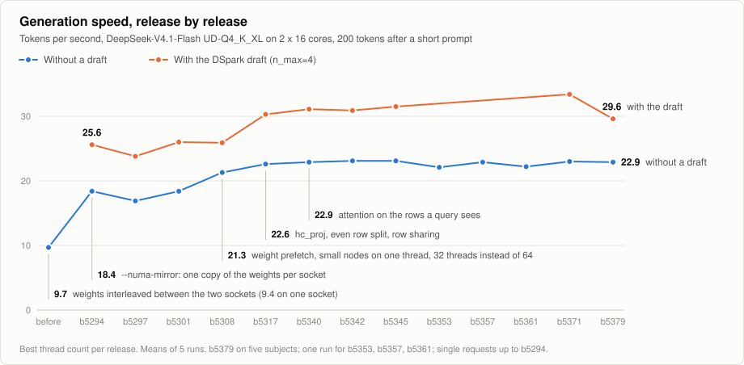
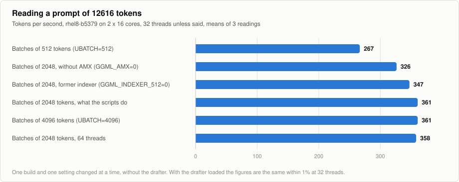

# Release by release

[README](../../README.md) · [changes](changes.md) · [measurements](measurements.md) · [setup](setup.md) · [DeepSeek Harness](harness.md)

Every release of this fork, what it changed, and what was measured with it on the 2-socket server (2 x 16 cores, 200 tokens generated). The figures are tokens per second. "Long prompt" is the generation after a prompt of 3159 to 3165 tokens up to `rhel8-b5345` and of 19714 tokens from `rhel8-b5353` on (15761 for `rhel8-b5361`, 12616 for `rhel8-b5371`); "prompt read" is the speed at which that prompt was read. An empty cell was not measured: a release that only fixes something, or that the next one replaced the same day.

<picture>
  <source media="(prefers-color-scheme: dark)" srcset="../../media/deepseek-releases-dark.svg">
  
</picture>

The chart takes, for each release that was measured, the short-prompt figures of the table below at the best thread count measured (64 threads up to `rhel8-b5301`, 32 from `rhel8-b5308` on, and 64 again for the draft figure of `rhel8-b5371`, 33.4). From `rhel8-b5379` on a figure with the draft is a mean over five subjects, 29.6 at 32 threads; on the subject of the earlier points that run gives 29.8 at 32 threads and 31.5 at 64. `python3 scripts/release-chart.py` draws it again from the figures written in that script.

<picture>
  <source media="(prefers-color-scheme: dark)" srcset="../../media/deepseek-prompt-dark.svg">
  
</picture>

The reading of a long prompt did not move before `rhel8-b5360`. The bars are one build, `rhel8-b5379`, with one setting changed at a time, each one the mean of 3 readings of a new text of 12616 tokens. Batches of 2048 tokens instead of 512 give 35%: with `--swa-compress` the server computes the 19 decoder layers of DeepSeek-V4.1 for the last 256 tokens of a batch only, in batches of 2048 one token of the prompt in eight instead of one in two. Batches of 4096 give nothing more: the attention of the other 21 layers takes a larger share of a batch as it grows (28% of its time at 512 tokens, 33.5% at 2048, 38.6% at 4096), and that takes back what the decoder layers give. The tiles of AMX give 10.5% (361 tokens/s against 326 with `GGML_AMX=0`), the AVX-512 indexer 3.9%. One thread per logical CPU reads at the speed of one per core (358 and 361). For the generation one thread per core is ahead in every column of that run: without the draft 22.9 against 21.5, and 21.5 against 20.1 after the long prompt; with the draft, as means over five subjects, 29.6 against 28.3 and 24.2 against 23.6, a step of the draft taking 80 ms against 83. In the run of `rhel8-b5371`, on a single subject, one per logical CPU had given the best figure with the draft after a short prompt, 33.4 against 30.9, and on that subject it is still ahead (31.5 against 29.8). 32 threads for one token and 64 for batches (`32/64`) is the slowest setting with the draft, 24.9 and 21.3: after a graph on 32 threads the 32 others take 5 ms to wake up for the graph of the drafter, and a step lasts 94 ms instead of 83. From `rhel8-b5381` on `deepseek.sh` starts one thread per core in both cases; `T=64` in `~/.deepseek.conf` or in front of `deepseek.sh` sets another. The generation after the prompt runs at the same speed whatever the batch size.

| Release | What it changed | Threads | Short prompt | With the draft | Long prompt | Long prompt, draft | Prompt read |
|---|---|---|---|---|---|---|---|
| `rhel8-b5284`, 19 Nov | First release: CPU binaries for RHEL 8 (glibc 2.28). The DeepSeek-V4.1 GGUFs of upstream llama.cpp load as they are, MXFP8 engram table included. | | | | | | |
| `rhel8-b5288` | The DSpark draft of upstream llama.cpp loads (`-md ... --spec-type dspark`). | | | | | | |
| `rhel8-b5290` | The data of MXFP8 tensors is checked when a model loads. | | | | | | |
| | Before `--numa-mirror`: all the weights on one NUMA node, then interleaved between the two | 32 | 9.4, 9.7 | | | | |
| `rhel8-b5293`, 20 Nov | `--numa-mirror`: one copy of the weights per NUMA node, each thread reads from its own socket. Measured with the next release. | | | | | | |
| `rhel8-b5294` | Fix: flash attention gives the same result with any number of threads. | 32 | 17.1 | | | | |
| | | 64 | 18.4 | 25.6 | | | |
| | | 16 | 12.2 | | | | |
| `rhel8-b5296` | Small nodes computed by one thread, first attempt. | | | | | | |
| `rhel8-b5297` | Fix: the Markov table of the DSpark draft is not repacked. Slower by 8%: the first attempt at serial nodes, taken back in the next release. | 64 | 16.9 | 23.8 | | | |
| `rhel8-b5301` | `GGML_PROFILE=1`, the profile of the graphs. | 64 | 18.4 | 26.0 | | | |
| | | 32 | 18.0 | | | | |
| | | 16 | 12.4 | | | | |
| `rhel8-b5305` | Serial small nodes, second attempt: thread 0 computes them alone and the others do not meet for them. `rms_norm`, `hc_post`, `rope` and `argmax` take less time. Measured with the next release. | | | | | | |
| `rhel8-b5308` | Weight prefetch for `Q8_0_R8` and `MXFP4_R8`. From here on 32 threads are faster than 64. | 64 | 20.0 | 25.9 | | | |
| | | 32 | 21.3 | | | | |
| | The same with `IQK_PREFETCH=0`, then with `GGML_SERIAL_NODES=0` | 64 | 19.4, 19.3 | 25.1 (no prefetch) | | | |
| `rhel8-b5313` | Weight prefetch for `Q4_K_R4`, `Q5_K_R4`, `Q6_K_R4`. `llama-quantize ... COPY --custom-q` requantizes only the tensors a rule names. | | | | | | |
| `rhel8-b5315` | `hc_proj`: the norm, the projection and the collapse of the hyper-connections in one node. The rows of `Q8_0_R8` split evenly between the threads. Measured with the next release. | | | | | | |
| `rhel8-b5317` | Row sharing: a thread that is done takes rows the others have not started. | 32 | 22.6 | 30.3 | | | |
| | | 64 | 20.8 | | | | |
| | The same with `GGML_SHARE_ROWS=0`, then with `GGML_HC_PROJ=0` | 32 | 22.2, 20.5 | 30.1, 27.3 | | | |
| `rhel8-b5334`, 21 Nov | Brought up to date with ik_llama.cpp. The mean of the streams is computed only for the layers the draft reads. | | | | | | |
| `rhel8-b5335` | The DeepSeek scripts are in the release: `deepseek.sh`, `charger-deepseek.sh`, `drafter.sh`, `mesure.sh`, `profil.sh`, `recompresser.sh`. | | | | | | |
| `rhel8-b5338` | Attention with one K/V head: fix of the sinks for a token decoded alone, attention on the rows a query sees instead of the whole padded cache, all the threads for a draft. Measured with the next release. | | | | | | |
| `rhel8-b5340` | `--webui llamacpp`, the current web UI of llama.cpp. | 32 | 22.9 | 31.1 | 21.4 | 26.1 | 236 |
| `rhel8-b5342` | The threads of the attention in a grid, groups of rows by groups of heads. | 32 | 23.1 | 30.9 | 21.7 | 24.5 | |
| `rhel8-b5345` | The index lists of a draft on the same grid, each token on its own rows. | 32 | 23.1 | 31.5 | 21.9 | 27.7 | 234 |
| `rhel8-b5347` | Tool calls: `{}` in a schema is any value, and a tool that is not `strict` gets open objects. Metabase could not get a query written before. | | | | | | |
| `rhel8-b5349` | The number of row groups of the attention grid is chosen from what `rhel8-b5345` measured. | | | | | | |
| `rhel8-b5350` | The attention reads the cache of DeepSeek-V4 in its two parts, without copying them together first: 1.3 ms of a draft step at 3165 tokens of context, more with a longer one. It had a fault, see `rhel8-b5357`. | | | | | | |
| `rhel8-b5352`, 22 Nov | `harness.sh`, DeepSeek Harness on the server. The fields of DeepSeek's API (`thinking`, `reasoning_effort`). | | | | | | |
| `rhel8-b5353` | Unsloth's chat template is recognized as DeepSeek's, so the tool-call handling of `rhel8-b5347` reaches a server started from Unsloth's files. Prompts as DeepSeek's reference builds them. One run. A request that ends in a tool call, with the draft: 33.9. | 32 | 22.1 | | 21.2 | | 230 |
| `rhel8-b5357` | Fix: in `rhel8-b5350` to `rhel8-b5353` the result of an attention node could be written over cache rows it still had to read, when several tokens were decoded together with one row group: wrong values, and an abort after the 19714-token prompt with `GGML_FA_ROW_GROUPS=1` or `-1`. `GGML_POISON=1`. One run. | 32 | 22.9 | | 21.2 | | 230 |
| `rhel8-b5360` | The indexer of DeepSeek-V4 with AVX-512: 5% to 10% of a prompt batch and 3% of a generated token went there at 20000 tokens of context. On 4 cores, a batch of 512 tokens over 5120 rows takes 28 ms instead of 160. Fix of the rounding of the buckets in the former way. Measured with the next release. | | | | | | |
| `rhel8-b5361` | `UBATCH=<n>` in `deepseek.sh` and `profil.sh` sets the size of the prompt batches, still 512 unless it is set. One run. With the indexer of `rhel8-b5360`, `INDEXER_TOPK` takes 30 ms of a 512-token batch instead of 108, and 0.55 ms of a generated token instead of 1.03. | 32 | 22.2 | | 21.1 | | 245 |
| | The same with `GGML_INDEXER_512=0`, the former indexer | 32 | 22.6 | | 21.6 | | 236 |
| | The same with `UBATCH=2048`: the 19 decoder layers, computed for the last 256 tokens of a batch only, see one token of the prompt in eight instead of one in two; a batch takes 2.63 ms per token plus 0.71 s | 32 | 22.5 | | 21.7 | | 329 |
| `rhel8-b5369` | The scripts read the prompt in batches of 2048 tokens unless `UBATCH` says otherwise. The binaries are built from the sources of `rhel8-b5361`, whose line above gives the figures. | | | | | | |
| `rhel8-b5370` | `profil.sh` measures in one run without and with the drafter, with one thread per core and one per logical CPU, after a short and after a long prompt, and ends with a table of the passes. Same sources for the binaries. | | | | | | |
| `rhel8-b5371` | `profil.sh` by default: every switch compared, batches of 512 and of 4096 tokens, 5 tries per pass of which 3 read a new long text, the lowest and the highest try in the table. `RAPIDE=1` for the short version. Same sources for the binaries: these are the figures of `rhel8-b5361` measured properly, 5 tries each, the prompt read 3 times. | 32 | 23.0 | 30.9 | 21.4 | 26.4 | 326 |
| | | 64 | 21.7 | 33.4 | 20.3 | 23.4 | 339 |
| | The same with `UBATCH=512`, then with `UBATCH=4096` | 32 | | | 21.7, 21.6 | 25.9, 26.2 | 241, 325 |
| | The same with `GGML_INDEXER_512=0`, the former indexer | 32 | | | 21.5 | 24.4 | 315 |
| | The same with `IQK_PREFETCH=0`, then `GGML_FA_SKIP_MASKED=0`, then `GGML_HC_PROJ=0`: the three switches that cost the most when they are off | 32 | | | 18.8, 19.7, 20.0 | 23.1, 23.7, 23.7 | 321, 324, 324 |
| | The same with `GGML_LAZY_CONCAT=0`, then `GGML_SHARE_ROWS=0`, then `GGML_SERIAL_NODES=0`, then `GGML_FA_ROW_GROUPS=-1` | 32 | | | 21.4, 21.4, 21.3, 21.3 | 25.2, 26.2, 26.8, 26.1 | 326, 325, 326, 324 |
| `rhel8-b5374`, 23 Nov | A batch of 48 tokens or more goes through the tiles of Intel AMX for its products with the `Q8_0_R8` matrices, as bf16 (`GGML_AMX=0` to compare). These products were 21% of a prompt batch in the profile of `rhel8-b5371`; on 4 Sapphire Rapids cores they take about half the time, and in the graph of a 1736-token batch of the model `attn_q_b` takes 1.2 s instead of 3.4, `attn_output_a` and `attn_output_b` 1.3 and 1.4 s instead of 2.9 and 3.1. The server says at its start whether it uses AMX. `profil.sh` writes the kernel, the AMX flags of the processor and the huge pages of the RAM disk in the head of its result. Measured with `rhel8-b5379`: the server has AMX (kernel 4.18.0-553 of RHEL 8.10) and reads a prompt of 12616 tokens at 361 tokens/s against 326 with `GGML_AMX=0`. | | | | | | |
| `rhel8-b5377`, 24 Nov | `deepseek.sh` starts with the thread count that was the fastest in the run of `rhel8-b5371`: one per logical CPU with the draft, one per core without (`T` sets another, `TB` the threads for batches of tokens). `profil.sh` measures 32, 64 and 32/64 threads (32 for a single token, 64 for batches), asks for a text on another subject at each try, and ends with the fastest thread count column by column and with what each switch changes. Same sources for the binaries as `rhel8-b5374`. | | | | | | |
| `rhel8-b5379`, 26 Nov | A request larger than the context is refused without being read: the server read it for 6 to 7 minutes after it had answered 400. Seen in the log of the server in use with `rhel8-b5377`, the draft and an agent whose conversation grows to the 131072 tokens of the context. In that log, between 28000 and 121000 tokens of context, the text is generated at 21.7 to 23.9 tokens/s when 60% to 70% of the draft is accepted (12 answers of 640 to 4150 tokens) and at 26 to 31 when 75% to 90% is, a step of the draft taking 96 to 105 ms whatever the context; a prompt is read at 338 tokens/s around 35000 tokens of context, 306 around 90000 and 287 to 298 between 110000 and 128000. The figures of this line and of the next ones are the run of `profil.sh` with this build: 5 tries per pass, each on another subject, the long prompt read 3 times. | 32 | 22.9 | 29.6 | 21.5 | 24.2 | 361 |
| | | 64 | 21.5 | 28.3 | 20.1 | 23.6 | 358 |
| | 32 threads for one token, 64 for batches of tokens (`-t 32 -tb 64`) | 32/64 | 22.7 | 24.9 | 21.4 | 21.3 | 355 |
| | The same with `GGML_AMX=0`. In this run a pass with one setting changed has 32 threads without the draft and 64 with it; the prompt figure is the one without the draft | 32, 64 | | | 21.6 | 23.9 | 326 |
| | The same with `UBATCH=512`, then with `UBATCH=4096` | 32, 64 | | | 21.8, 21.6 | 23.7, 24.0 | 267, 361 |
| | The same with `GGML_INDEXER_512=0`, the former indexer | 32, 64 | | | 21.4 | 23.5 | 347 |
| | The same with `IQK_PREFETCH=0`, then `GGML_FA_SKIP_MASKED=0`, then `GGML_HC_PROJ=0`: the three switches that cost the most when they are off | 32, 64 | | | 18.9, 19.6, 19.9 | 22.7, 21.5, 22.7 | 354, 357, 357 |
| | The same with `GGML_LAZY_CONCAT=0`, then `GGML_SHARE_ROWS=0`, then `GGML_SERIAL_NODES=0`, then `GGML_FA_ROW_GROUPS=-1` | 32, 64 | | | 21.1, 21.4, 21.3, 21.4 | 22.6, 23.7, 24.3, 22.8 | 359, 358, 359, 359 |
| `rhel8-b5381`, 26 Nov | `deepseek.sh`, `mesure.sh` and `drafter.sh` start one thread per core with or without the draft, the faster count in every column of the run above. `IQK_PREFETCH=<bytes>,<far bytes>,<level>` adds a second request for the weights from farther ahead, sent to the L2 cache, and sets the cache level of the first one; nothing changes without the variable, it is there to measure whether one core can read more than the 10 to 14 GB/s it reads now. `profil.sh` measures 32 and 64 threads (`32/64` on request) and writes, once the server has read the weights, how much of the RAM disk it maps as 2 MB pages. | | | | | | |
| `rhel8-b5383`, 26 Nov | `GGML_AMX_ATTN=1` in the environment sends the attention of a prompt batch through the AMX tiles as well, in bf16 (see [changes.md](changes.md)): the attention was a third of a prompt batch in the run of `rhel8-b5379`. Off unless asked, and not measured yet: `profil.sh` has it among its settings, and `env DRAFT= THREADS=32 VARS=GGML_AMX_ATTN=1 ./profil.sh` measures it alone. Nothing else changes in the binaries. | | | | | | |
| `rhel8-b5385`, 26 Nov | A correction that changes no result of a model: where the attention copies the rows of each token's list before computing on them (8 tokens or more read together, and fewer when the grid of threads is not used, as with `GGML_FA_SKIP_MASKED=0`), a list whose length is not a multiple of 32 gave a wrong result. The kernels take the rows 32 at a time and went on into rows and mask values that nobody had written. `test-flash-attn-threads` now has such lists (143, 150, 191 and 70 rows, 1 to 40 tokens): 72 of these 168 cases failed, the result 4% to 12% from the exact one, and not a number in 24 of them, all with V in rows of its own. The list is now made up to a multiple of 32 with rows the query does not see, and the 1148 cases pass in the seven ways `ctest` runs them. The graphs of DeepSeek-V4 and of GLM-5 make lists of a multiple of 256 rows, so they never met it; it was found by the test of the attention through AMX. | | | | | | |
| `rhel8-b5390`, 27 Nov | `--cache-ram-dir DIR` keeps the prompt cache of the server as files in DIR, for a directory on a RAM disk: the conversations it set aside are still there after a restart, and after a crash each one is found as it was last written (see [changes.md](changes.md)). With `CACHE_DIR=/mnt/dscache/cache` in `~/.deepseek.conf`, `deepseek.sh` mounts the RAM disk `/mnt/dscache` for the account alone (120G, `CACHE_DISK`) and gives the directory to the server. The server now also stops in order when its terminal closes (SIGHUP), as it does for Ctrl+C. Off unless asked: the files are checked by a test, the way through the server with a model is not, and the first run with it is that test. In the same build, the profile (`GGML_PROFILE=1`) counts the weights of an expert once when several tokens of a graph picked it, as they are read once. It counted them once per token, so the read rate of the experts was too high for every graph of more than one token (the verification of a draft, a prompt batch); the figures for a token decoded alone do not change. There is no `rhel8-b5389`: its build was replaced by this one before it ended. | | | | | | |
| | Measured: no draft, 3 tries per pass, the prompt read twice | 32 | 22.8 | | 21.7 | | 359 |
| | The same with `GGML_AMX_ATTN=1`: the attention of a batch takes 567 ms instead of 1559 | 32 | | | 21.7 | | 452 |
| | The same with `IQK_PREFETCH=1024`, `16384`, `4096,32768`, `4096,131072`, `1024,16384`, `16384,0,1`, `65536,0,1`: none is faster than the 4096 bytes of the kernels | 32 | | | 20.4, 21.4, 21.5, 20.9, 21.4, 21.7, 20.7 | | 353, 356, 358, 358, 355, 357, 352 |
| `rhel8-b5397`, 27 Nov | Fewer threads waiting while a token is generated (see [changes.md](changes.md), row sharing). In the shared expert (`ffn_up_shexp`, up and gate computed together) a thread that is done with its rows takes rows the others have not started, as in the other large matrices; in the routed experts (`ffn_up_exps`, `ffn_down_exps`) a thread that finds no chunk left takes the end of the chunks the others are still on. In the profile of `rhel8-b5390` the threads were busy 82% of the first node and 91 to 93% of the other two for a token, against 94 to 97% in the matrices that share their rows; the three are 17 of the 45.5 ms of a token. Every value is the one it was, bit for bit (`test-share-rows`: 2 to 64 threads, 1 to 9 tokens, experts in `MXFP4_R8` and in `Q8_0_R8`), and `GGML_SHARE_ROWS=0` turns it off. Measured below. Also in the package: the README and the notes of a release rewritten, the measurements above written down. | | | | | | |
| | Measured: no draft, 3 tries per pass, the attention through AMX on (`GGML_AMX_ATTN=1` in `~/.deepseek.conf`). For a token the shared expert takes 2.91 ms instead of 3.09 (threads busy 93% instead of 83); the routed experts 13.83 ms instead of 13.95 (busy 96 to 97% instead of 91 to 93), within what two runs differ by. The texts are those of `rhel8-b5390` | 32 | 23.1 | | 21.7 | | 455 |
| | The same with `GGML_SHARE_ROWS=0` | 32 | | | 21.6 | | 454 |
| `rhel8-b5399`, 27 Nov | The routed experts are computed as before `rhel8-b5397`: letting the threads take the end of each other's chunks made them busier and the nodes no shorter. The shared expert keeps its sharing, which was measured. `profil.sh` compares settings of the draft (`SPEC=dspark:n_max=4,p_min=0.5` among `VARS`; `SANS_DRAFTER=0` leaves out the passes without the draft). | | | | | | |
| | Measured with the draft, 5 subjects: a step of 78.2 ms gives 2.35 tokens, 62% of the proposed tokens accepted | 32 | | 30.4 | | | |
| | The same with `SPEC=dspark:n_max=4,p_min=0.5`, then `p_min=0.3`, `p_min=0`, `n_max=5,p_min=0.3`, `n_max=5,p_min=0`: none is faster than the setting in use | 32 | | 30.8, 30.1, 30.6, 30.1, 28.8 | | | |

From `rhel8-b5297` on the figures are means of 5 runs, except where one run is said; before, they are single requests. The runs of one build differ by up to 3%. Those with the draft (DSpark, `n_max=4`) also move with the share of draft tokens the model accepts, which depends on the text: 55% to 75% in these runs. With `rhel8-b5371` the 5 tries of a pass with the draft go from 24.1 to 27.8 tokens/s, so a difference of less than 1 token/s between two passes with the draft says nothing; that is the case of the four switches of the last line. The 33.4 at 64 threads after a short prompt is the highest generation speed measured so far: 1000 tokens in 360 steps of the draft (75% of its tokens accepted, 83 ms a step) against 405 steps at 32 threads (63%, 80 ms). After the long prompt it is the other way round: 490 steps of 87 ms at 64 threads (55% accepted), 447 of 85 ms at 32 (60%). From `rhel8-b5377` on the tries of a pass ask for texts on different subjects, so a figure with the draft is a mean over 5 texts and no longer the speed of one; the first try keeps the subject of the earlier runs. With `rhel8-b5379` the five subjects give 27.2 to 33.6 tokens/s at 32 threads and 22.9 to 32.6 at 64 after a short prompt, with 62% and 64% of the draft accepted; the 32/64 pass wrote the same texts as the 64-thread one (same fingerprint of the first, same counts of draft steps and of tokens over the five), so its 24.9 against 28.3 is the setting and not the text. In all these runs the draft model is the file as downloaded, not the repacked one that `deepseek.sh` takes when it is there. `rhel8-b5340` to `rhel8-b5345` generate another text than `rhel8-b5317` because of the fix of the sinks.

From the first measurement to the last one, on the same machine and the same model files: 9.4 tokens/s with the weights on one node, 17.1 with a copy per node, 22.9 now; with the draft, 25.6 then, and now 29.6 as a mean over five subjects, from 27.2 to 33.6 with the subject (on the subject of the first measurements: 33.4 at 64 threads with `rhel8-b5371`, 31.5 with `rhel8-b5379`). A prompt was read at 230 to 236 tokens/s in every release up to `rhel8-b5357`, at 326 since the scripts of `rhel8-b5369`, and at 361 since the AMX path of `rhel8-b5374`; with the attention through AMX as well (`GGML_AMX_ATTN=1`, on request), at 452 against 359 in the run of `rhel8-b5390`.
